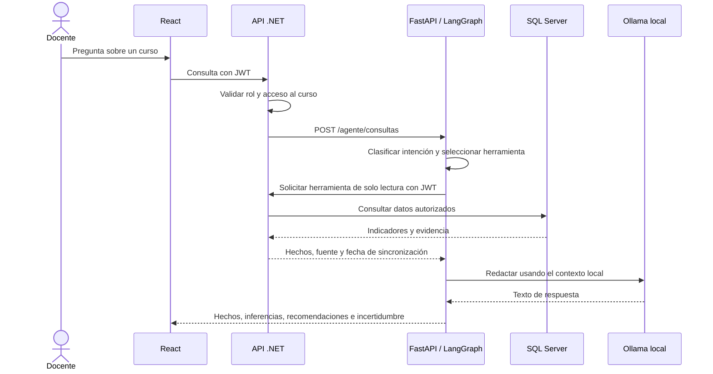

# Diseño técnico del Sprint 2 — aportes de Diego

Este documento complementa [Planificacion_Sprint2_AcademIA.docx](./Planificacion_Sprint2_AcademIA.docx) con las especificaciones, modelos y decisiones técnicas correspondientes a las tareas asignadas a Diego. El Sprint 2 entrega especificación y diseño; no introduce código de producción.

## Alcance de las tareas

| Azure Boards | Tarea | Entregable |
|---|---|---|
| #28 | TA-10.1 | Historia y criterios de aceptación de HU-10 |
| #30 | TA-10.3 | Modelo y diseño técnico del análisis grupal |
| #32 | TA-11.1 | Historia, criterios de aceptación y reglas de HU-11 |
| #34 | TA-11.3 | Arquitectura del servicio de IA |
| #39 | TA-12.3 | Modelo y flujo de recomendaciones |
| #45 | TA-14.1 | Historia y criterios de aceptación de HU-14 |
| #52 | TE-03 | Consolidación y revisión de coherencia |

Los mockups, modelos de datos transversales y casos de prueba asignados a otros integrantes no se sustituyen ni se duplican aquí.

## HU-10 — Análisis grupal del curso

**Historia.** Como docente, quiero identificar las actividades con resultados bajos y la tendencia del rendimiento del curso, para ajustar mi enseñanza. (RF-08, RN-07, RN-08, RN-09)

### Criterios de aceptación

- **CA-10.1:** Con datos sincronizados, el docente ve las actividades ordenadas por promedio y se resaltan las que están por debajo del umbral configurable.
- **CA-10.2:** La tendencia muestra la evolución del promedio del curso por fecha de evaluación y con escala explícita.
- **CA-10.3:** Si una actividad tiene menos calificaciones que el mínimo definido, aparece como «datos insuficientes» y no se concluye sobre ella.
- **CA-10.4:** Cada resultado identifica la fuente y la fecha de la última sincronización.

### Parámetros acordados con el Product Owner

- Umbral inicial de resultado bajo: **6/10**; se considera bajo un promedio inferior al umbral.
- Mínimo para considerar suficiente la muestra: **7 calificaciones**. Con menos de siete, el resultado se marca como insuficiente.
- Ambos valores permanecen configurables.

### Modelo y diseño

| DTO | Atributos | Uso |
|---|---|---|
| `ResultadoActividadDto` | `ItemId`, `Nombre`, `Promedio`, `Escala`, `NumCalificaciones`, `BajoUmbral`, `DatosInsuficientes` | Resultado agregado por actividad. |
| `PuntoTendenciaDto` | `Fecha`, `PromedioCurso`, `Escala` | Punto de la serie temporal del curso. |

- **Servicio:** Servicio Académico; SQL Server calcula agregados sobre calificaciones sincronizadas.
- **Endpoint previsto:** `GET /cursos/{cursoId}/analisis-grupal`, protegido por autorización del curso.
- Las notas ausentes no cuentan como cero. El promedio usa la escala del ítem obtenida de Moodle.
- La clasificación de suficiencia usa `NumCalificaciones < 7`; el umbral se evalúa solo cuando la muestra es suficiente.
- La respuesta conserva la fuente y la fecha de sincronización para satisfacer RN-09.

## HU-11 — Consulta al agente de IA

**Historia.** Como docente, quiero hacer preguntas sobre mis cursos y recibir respuestas basadas en datos reales, para obtener información sin navegar por varias pantallas. (RF-09, RN-14, RN-18, RN-19, RNF-08)

### Criterios de aceptación

- **CA-11.1:** La respuesta se basa en datos obtenidos mediante herramientas controladas del sistema y no presenta hechos inventados.
- **CA-11.2:** La respuesta separa explícitamente hechos, inferencias y recomendaciones.
- **CA-11.3:** Cuando faltan datos, el agente reconoce la incertidumbre y no inventa información.
- **CA-11.4:** La consulta de un curso no autorizado se rechaza y el agente informa el impedimento.
- **CA-11.5:** El modelo se ejecuta localmente y no se envían datos identificables a servicios externos.

### Arquitectura propuesta

- **Servicio:** Python / FastAPI con un grafo de LangGraph y Ollama dentro de la infraestructura del proyecto.
- **Herramientas de solo lectura:** `obtener_indicadores_curso`, `obtener_seguimiento_estudiante`, `listar_alertas` y `obtener_resultados_actividades`.
- Las herramientas consumen servicios .NET con el JWT del docente. La autorización por curso se aplica en el servicio de datos; el agente no consulta SQL Server directamente.
- El modelo redacta la respuesta a partir de resultados obtenidos por herramientas. Los hechos, su fuente y su fecha se conservan separados de inferencias y recomendaciones.
- Ninguna herramienta modifica datos. No se envían datos identificables a servicios externos; la incertidumbre se expresa cuando los resultados son incompletos.

## HU-12 — Recomendaciones pedagógicas

### Modelo

| Entidad | Atributos clave | Relación o regla |
|---|---|---|
| `Recomendacion` | `Id`, `CursoId`, `EstudianteId` (opcional), `Texto`, `Justificacion`, `IndicadoresRef`, `Estado`, `Fecha` | Vinculada a indicadores y, cuando corresponda, a alertas. |

Estados propuestos: `Propuesta`, `Aceptada`, `Ajustada` y `Descartada`.

### Flujo técnico

1. El Servicio de IA solicita indicadores y alertas mediante las herramientas controladas de HU-11.
2. Solo genera una propuesta si existe al menos un indicador que la justifique (RN-16).
3. El Servicio Académico almacena la propuesta y expone su estado al docente.
4. El docente puede aceptar, ajustar o descartar la propuesta; la decisión pedagógica permanece en manos del docente.
5. Si los datos son insuficientes, no se genera una recomendación y se informa el motivo.

Endpoints previstos:

- `POST /cursos/{id}/recomendaciones/generar`
- `GET /cursos/{id}/recomendaciones`
- `PATCH /recomendaciones/{id}/estado`

## HU-14 — Registro de auditoría

**Historia.** Como administrador técnico, quiero consultar el registro de sincronizaciones, consultas y herramientas usadas por el agente, para garantizar la trazabilidad sin exponer secretos. (RF-12, RN-15)

### Criterios de aceptación

- **CA-14.1:** Cada sincronización, consulta al agente o uso de herramienta registra usuario, fecha y resultado.
- **CA-14.2:** Los registros no contienen credenciales, tokens ni contraseñas.
- **CA-14.3:** El administrador puede filtrar por tipo y rango de fechas, con resultados paginados.
- **CA-14.4:** Un docente que intente consultar la auditoría recibe HTTP 403.

La entidad prevista es `RegistroAuditoria`, con `Id`, `FechaHora`, `UsuarioId`, `Tipo`, `Detalle` y `Resultado`. El Servicio de Auditoría (.NET 10) recibe eventos de los demás servicios; antes de persistirlos elimina los campos sensibles. El endpoint previsto es `GET /auditoria`, con filtros y paginación.

## TE-03 — Consolidación y revisión

Este complemento se integra con la planificación del Sprint 2 y el informe del Sprint 1 mediante las siguientes decisiones:

- Se conservan las entidades y reglas establecidas en Sprint 1; los nuevos diseños amplían sus datos académicos y servicios.
- La autorización se valida por curso en los servicios .NET; el agente usa únicamente herramientas controladas de lectura.
- Las métricas explicitan escala, suficiencia de datos, fuente y sincronización; las recomendaciones incluyen indicadores justificativos.
- La auditoría depura secretos y limita la consulta al administrador técnico.
- Los mockups y casos de prueba siguen siendo entregables de los integrantes responsables en la planificación.

Documento de diseño para revisión del Product Owner; la implementación de producción queda fuera del alcance de este Sprint.
