**UNIVERSIDAD TÉCNICA DE AMBATO**
**FACULTAD DE INGENIERÍA EN SISTEMAS, ELECTRÓNICA E INDUSTRIAL**
**CARRERA DE INGENIERÍA EN SOFTWARE**
**CICLO ACADÉMICO: JULIO – DICIEMBRE 2026**

---

# AcademIA
## INFORME DEL SPRINT 2

**Planificación y resultados**

**Sistema inteligente de seguimiento del rendimiento académico integrado con Moodle**

| | |
|---|---|
| **Product Owner** | Ing. Hernán Naranjo, Mg. |
| **Equipo de desarrollo** | Curillo Pilamunga Diego Alexander |
| | Manobanda Masabanda Luis Alfredo |
| | Redroban Chimbo Joselyn Amparo |
| | Quispe Nasimba Daniela Alejandra |
| **Fecha de planificación** | 04/11/2026 |
| **Período del Sprint 2** | 04/11/2026 – 12/11/2026 |

**JULIO – DICIEMBRE 2026**
**AMBATO**

---

# ÍNDICE

1. INTRODUCCIÓN
   - 1.1 Descripción del problema
   - 1.2 Descripción del proyecto
   - 1.3 Alcance del Sprint 2
   - 1.4 Objetivos
   - 1.5 Marco de referencia
2. JUSTIFICACIÓN DEL STACK TECNOLÓGICO
3. ARQUITECTURA DEL SISTEMA
   - 3.1 Descripción general
   - 3.2 Componentes y responsabilidades
   - 3.3 Flujo conceptual de una consulta de seguimiento, alerta o informe
   - 3.4 Diagrama de arquitectura
4. RECURSOS DEL PROYECTO
5. REQUERIMIENTOS DEL SISTEMA
   - 5.1 Requerimientos funcionales
   - 5.2 Requerimientos no funcionales
   - 5.3 Reglas de negocio
6. METODOLOGÍA SCRUM APLICADA
   - 6.1 Roles
   - 6.2 Eventos y artefactos
   - 6.3 Definición de Terminado
7. DATOS GENERALES DE LA PLANIFICACIÓN
8. PARTICIPANTES DE LA REUNIÓN
9. AGENDA DE LA REUNIÓN DE PLANIFICACIÓN
10. OBJETIVO DEL SPRINT 2
11. REVISIÓN Y PRIORIZACIÓN DEL PRODUCT BACKLOG
12. ANÁLISIS DE CAPACIDAD DEL SPRINT 2
13. HISTORIAS DE USUARIO SELECCIONADAS
    - 13.1 Tabla resumen
    - 13.2 Fichas, mockups y desglose de tareas por Historia de Usuario
14. CRITERIOS DE ACEPTACIÓN
15. ESTIMACIÓN DE LAS HISTORIAS DE USUARIO
16. DESCOMPOSICIÓN DE HISTORIAS DE USUARIO EN TAREAS
17. SPRINT BACKLOG
    - 17.1 Tablero Scrum (estado inicial)
    - 17.2 Resumen del Sprint Backlog
18. DISTRIBUCIÓN DE RESPONSABILIDADES
19. PLAN DE TRABAJO DEL SPRINT 2
    - 19.1 Orden de elaboración y dependencias
    - 19.2 Cronograma por integrante
    - 19.3 Riesgos e impedimentos
    - 19.4 Criterios de finalización del Sprint 2
20. DEFINICIÓN DE TERMINADO (DEFINITION OF DONE)
21. COMPROMISO DEL EQUIPO
22. CONCLUSIONES DE LA PLANIFICACIÓN
23. RESULTADOS DEL SPRINT 2
24. TESTING DE LAS HISTORIAS DE USUARIO
25. DIAGRAMAS
    - 25.1 Arquitectura actualizada
    - 25.2 Modelo de datos actualizado
    - 25.3 Secuencia: evaluación de alertas
    - 25.4 Secuencia: generación y descarga de informe
26. RETROSPECTIVA DEL SPRINT 2
27. MÉTRICAS Y CONCLUSIÓN

---

# 1. INTRODUCCIÓN

## 1.1 Descripción del problema

El Sprint 1 dejó a AcademIA con acceso por roles, conexión con Moodle, sincronización y un panel básico de indicadores. Sin embargo, el docente todavía no puede:

- Consultar la situación de un estudiante concreto (evolución de notas y estado de cada actividad) sin revisar Moodle actividad por actividad.
- Recibir avisos oportunos sobre descensos en evaluaciones, atrasos o baja finalización, con la evidencia que los sustenta.
- Identificar las actividades con resultados bajos y la tendencia del curso.
- Consultar a un agente de IA, recibir recomendaciones pedagógicas justificadas ni documentar los hallazgos en un informe.
- Garantizar la trazabilidad de lo que ocurre en el sistema mediante un registro de auditoría sin secretos.

El Sprint 2 aborda estos requerimientos (RF-06 a RF-12) manteniendo el principio de que el sistema asiste al docente y no sustituye su criterio profesional.

## 1.2 Descripción del proyecto

AcademIA (EduMonitor) es un sistema inteligente de seguimiento y análisis del rendimiento académico integrado con Moodle mediante sus Servicios Web REST, desarrollado en tres Sprints bajo Scrum y sobre una arquitectura de microservicios (.NET 10, React.js, SQL Server, RabbitMQ y, para el agente, Python).

## 1.3 Alcance del Sprint 2

**Planificación original.** El Sprint 2 se planificó el 04/11/2026 como un Sprint de **especificación y diseño**, sin código de producción: siete Historias de Usuario (HU-08 a HU-14), mockups M-07 a M-14, modelo de datos y diseños ampliados, y un plan de pruebas funcionales con matriz de trazabilidad (30 criterios y 30 casos).

**Decisión del equipo.** Durante el Sprint el equipo decidió ir más allá del compromiso y **implementar** las historias, probarlas e informar los resultados. Este informe mantiene la planificación original (secciones 1 a 22) y agrega los resultados reales (secciones 23 a 27), indicando con claridad qué está implementado y verificado y qué permanece pendiente de evidencia.

**Incluye:**

- Especificación y diseño de RF-06 a RF-12 (HU-08 a HU-14) y sus mockups M-07 a M-14.
- Implementación de HU-08 (seguimiento individual), HU-09 (reglas y alertas) y HU-13 (informes) por Joselyn Redroban, y de HU-10, HU-11, HU-12 y HU-14 (análisis grupal, agente de IA, recomendaciones y auditoría) por Diego Curillo.
- Ejecución de las pruebas funcionales de HU-08, HU-09 y HU-13 (13 casos).

**No incluye:**

- Ejecución de las pruebas funcionales de HU-10, HU-11, HU-12 y HU-14, que permanece pendiente de evidencia.
- Pruebas automatizadas (unitarias o de integración), recorrido visual documentado con capturas y despliegue.
- Planificación del Sprint 3.

## 1.4 Objetivos

**Objetivo general del proyecto:** desarrollar un sistema basado en microservicios, integrado con Moodle, que permita al docente consultar indicadores del rendimiento académico de sus cursos, detectar tempranamente dificultades y recibir recomendaciones pedagógicas generadas por un agente de inteligencia artificial.

**Objetivos específicos del Sprint 2:**

1. Redactar las Historias de Usuario de RF-06 a RF-12 con criterios de aceptación verificables.
2. Diseñar los mockups de las pantallas nuevas (M-07 a M-14).
3. Elaborar el modelo de datos ampliado y los diseños técnicos de los servicios nuevos, incluido el servicio de IA.
4. Plantear los casos de prueba funcional asociados a cada criterio de aceptación y su trazabilidad.
5. Validar el paquete con el Product Owner y presentarlo el 12/11/2026.
6. (Ampliación) Implementar las historias en React y .NET, y ejecutar las pruebas funcionales de las historias del frontend a cargo de Joselyn Redroban.

## 1.5 Marco de referencia

No se identifica normativa externa específica aplicable. Se aplican los requerimientos no funcionales de **seguridad (RNF-01)** y **privacidad (RNF-02)**, que condicionan especialmente el agente de IA: control de acceso por curso, mínimo privilegio, datos mínimos y prohibición de enviar información identificable a servicios externos sin autorización.

---

# 2. JUSTIFICACIÓN DEL STACK TECNOLÓGICO

| Tecnología | Justificación | ¿Se utiliza en el Sprint 2? |
|---|---|---|
| **React.js** (Frontend) | Componentes reutilizables para las pantallas de seguimiento, alertas, análisis grupal, agente, recomendaciones, informes y auditoría (M-07 a M-14). | Sí |
| **.NET 10 con Clean Architecture** | Separa dominio, casos de uso, infraestructura y API; el Middleware actúa como puerta de enlace y el servicio de Análisis concentra reglas, alertas e informes. | Sí |
| **SQL Server** | Persistencia relacional: proyección de cursos, reglas y estados de alerta, informes, recomendaciones y auditoría, mediante scripts versionados (`database/001` a `010`). | Sí |
| **RabbitMQ** | Mensajería de eventos entre la Integración con Moodle y el servicio de Análisis para actualizar la proyección del curso. | Sí |
| **Arquitectura de microservicios** | Identidad, Integración con Moodle, Análisis académico, Middleware y agente de IA como servicios independientes. | Sí |
| **Servicios Web REST de Moodle** | Fuente de cursos, matriculados, calificaciones y estados de actividad. | Sí |
| **Python / FastAPI** | Servicio del agente de IA expuesto como API (puerto 8010). | Sí (implementado por Diego Curillo) |
| **LangGraph y Ollama** | Orquestación del agente y modelo local que favorece la privacidad (RNF-02). | Según el diseño técnico del agente; su verificación está pendiente (sección 24) |

---

# 3. ARQUITECTURA DEL SISTEMA

## 3.1 Descripción general

Se mantiene la arquitectura de microservicios del Sprint 1. La aplicación React consume un único punto de entrada, el **Middleware** (puerto 5000), que valida el JWT, aplica la autorización por curso y reenvía las consultas al servicio de Análisis (puerto 5030), a la Integración con Moodle (5010) y al agente de IA (8010). El servicio de Análisis conserva una proyección (*snapshot*) de cada curso y calcula a partir de ella el seguimiento, las alertas, el análisis grupal, las recomendaciones y los informes.

## 3.2 Componentes y responsabilidades

| Componente | Responsabilidad | Estado en el Sprint 2 |
|---|---|---|
| **Cliente React.js** | Todas las pantallas, incluidas M-07 a M-14. | Ampliado |
| **Servicio de Identidad** (.NET 10, 5020) | Usuarios, roles y JWT con los cursos asignados (`course_id`). | Existente |
| **Servicio de Integración con Moodle** (.NET 10, 5010) | Conexión y consumo de los servicios web de Moodle; publica eventos a RabbitMQ. | Existente |
| **Servicio de Análisis académico** (.NET 10, 5030) | Proyección del curso, seguimiento individual, reglas y alertas, análisis grupal, recomendaciones e informes. | Nuevo |
| **Middleware** (.NET 10, 5000) | Puerta de enlace con autorización por curso, auditoría y consulta al agente. | Ampliado |
| **Agente de IA** (Python / FastAPI, 8010) | Consultas con herramientas de solo lectura y recomendaciones. | Nuevo |
| **SQL Server** | Persistencia relacional por servicio (`EduMonitor`, `EduMonitorIdentity`, `EduMonitorAnalysis`, `MoodleIntegration`). | Ampliado |
| **RabbitMQ** | Mensajería de eventos académicos. | Nuevo |
| **Moodle (externo)** | Fuente de los datos académicos. | Existente |

## 3.3 Flujo conceptual de una consulta de seguimiento, alerta o informe

1. El docente inicia sesión y recibe un JWT con su rol y los cursos asignados.
2. Selecciona un curso y React llama al Middleware, que valida que el curso esté en sus `course_id` (403 en caso contrario).
3. El Middleware reenvía la solicitud al servicio de Análisis, que lee la proyección del curso sincronizada desde Moodle.
4. Para las alertas, el servicio evalúa las reglas configuradas; si la sincronización es «Incompleta» no genera alertas por datos faltantes y avisa al docente.
5. El servicio devuelve el resultado con la fuente (Moodle) y la fecha de la última sincronización.
6. El Middleware registra el evento de auditoría (por ejemplo, `InformeGenerado`) y React presenta el resultado.

## 3.4 Diagrama de arquitectura

```
┌──────────────────────┐
│ Docente / Admin      │
│ técnico (navegador)  │
└──────────┬───────────┘
           │ REST + JWT
┌──────────▼───────────┐
│  React.js (5173)     │
└──────────┬───────────┘
           │
┌──────────▼───────────┐        ┌────────────────┐
│  Middleware (5000)   │───────►│ Identidad 5020 │
│  JWT · curso · audit │        └────────────────┘
└──┬─────────┬─────────┘
   │         │             ┌──────────────────────┐
   │         └────────────►│ Agente IA (8010)     │
   │                       │ FastAPI · Ollama     │
┌──▼───────────────┐      └──────────────────────┘
│ Análisis (5030)  │◄──── RabbitMQ ◄──── Integración Moodle (5010) ──► Moodle
└──┬───────────────┘
   │
┌──▼───────────────────────────┐
│ SQL Server (Express)         │
└──────────────────────────────┘
```

La figura gráfica se encuentra en `docs/diagramas/arquitectura.png` (versión del Sprint 1); la versión actualizada se describe en la sección 25.1.

---

# 4. RECURSOS DEL PROYECTO

**Tecnológicos (software)**

| Recurso | Uso |
|---|---|
| .NET 10 (ASP.NET Core) y Entity Framework Core | Microservicios y acceso a datos |
| SQL Server Express | Persistencia relacional (`localhost\SQLEXPRESS`) |
| React.js (Vite) | Interfaz web |
| RabbitMQ (Docker) | Mensajería de eventos |
| Python / FastAPI, LangGraph, Ollama | Agente de IA |
| Servicios Web REST de Moodle (instancia local) | Integración externa |
| Git y GitHub (ramas, Pull Requests hacia `develop`) | Control de versiones |
| PowerShell, `sqlcmd` y `curl` | Ejecución de las pruebas funcionales |
| Swagger (OpenAPI) | Documentación de endpoints |
| Visual Studio Code | Entorno de desarrollo |

**Hardware:** equipos de desarrollo con .NET 10 SDK, SQL Server Express, Node.js, Docker y una instancia Moodle local.

**Humanos:** Product Owner (Ing. Hernán Naranjo, Mg.) y cuatro integrantes del equipo de desarrollo.

**Datos y documentación:** requerimientos funcionales y no funcionales, `Planificacion_Sprint2_AcademIA.md`, `Pruebas_Funcionales_Sprint2.md` y datos académicos de prueba anonimizados (RNF-02).

---

# 5. REQUERIMIENTOS DEL SISTEMA

## 5.1 Requerimientos funcionales

| Código | Requerimiento | Descripción | Sprint |
|---|---|---|---|
| RF-01 a RF-05 | Autenticación, conexión Moodle, sincronización, gestión de cursos y panel básico | Entregados en el Sprint 1 | 1 |
| RF-06 | Seguimiento individual | Evolución de notas, actividades sin entrega, pendientes de calificar y completadas, diferenciando sus estados. | 2 |
| RF-07 | Alertas académicas | Reglas configurables para detectar descensos, atrasos y baja finalización, con evidencia y sin etiquetas definitivas. | 2 |
| RF-08 | Análisis grupal | Actividades con resultados bajos y tendencias de rendimiento del curso. | 2 |
| RF-09 | Agente de IA | Respuestas basadas en herramientas controladas, distinguiendo hechos, inferencias y recomendaciones. | 2 |
| RF-10 | Recomendaciones | Acciones de apoyo concretas y justificadas mediante indicadores. | 2 |
| RF-11 | Informe | Resúmenes consultables o descargables con período, métricas, hallazgos, recomendaciones y fecha de actualización. | 2 |
| RF-12 | Auditoría | Registro de sincronizaciones, consultas y herramientas del agente sin exponer secretos. | 2 |

## 5.2 Requerimientos no funcionales

Se mantienen RNF-01 (Seguridad), RNF-02 (Privacidad), RNF-03 (Confiabilidad), RNF-04 (Usabilidad), RNF-05 (Mantenibilidad), RNF-06 (Calidad), RNF-07 (Rendimiento) y RNF-08 (Transparencia) definidos en el Sprint 1.

## 5.3 Reglas de negocio

Las reglas RN-01 a RN-11 provienen del Sprint 1. Para este Sprint se detallan RN-12 a RN-15 y se incorporan RN-16 a RN-19.

| ID | Regla | Fuente | Evalúa | Historia |
|---|---|---|---|---|
| RN-12 | Las actividades se clasifican diferenciando sin entrega, pendientes de calificar y completadas; los estados no se mezclan. | RF-06 | Código | HU-08 |
| RN-13 | Las alertas aplican reglas configurables, muestran su evidencia y no establecen etiquetas definitivas sobre el estudiante. | RF-07, RNF-08 | Código y diseño | HU-09 |
| RN-14 | El agente de IA solo propone: usa herramientas controladas, distingue hechos, inferencias y recomendaciones, reconoce incertidumbre y la decisión pedagógica corresponde al docente. | RF-09, RF-10, RNF-08 | Diseño y docente | HU-11, HU-12 |
| RN-15 | La auditoría registra sincronizaciones, consultas y herramientas utilizadas sin exponer secretos. | RF-12, RNF-01 | Código | HU-14 |
| RN-16 | Toda recomendación se justifica con al menos un indicador académico; sin indicadores suficientes no se genera. | RF-10 | Código y diseño | HU-12 |
| RN-17 | Todo informe incluye período, métricas, hallazgos, recomendaciones y fecha de actualización de los datos, e indica si los datos están incompletos. | RF-11, RNF-03 | Código | HU-13 |
| RN-18 | El modelo de lenguaje se ejecuta de forma local y no se envía información identificable a servicios externos sin autorización. | RNF-02 | Diseño | HU-11 |
| RN-19 | El agente solo accede a los datos mediante herramientas de solo lectura y con los permisos del docente que consulta. | RF-09, RNF-01 | Código | HU-11 |

*Tabla 1. Reglas de negocio aplicables al Sprint 2*

---

# 6. METODOLOGÍA SCRUM APLICADA

## 6.1 Roles

| Integrante | Rol Scrum | Responsabilidad en el Sprint 2 |
|---|---|---|
| Ing. Hernán Naranjo, Mg. | Product Owner | Prioriza, aclara requerimientos y valida el paquete. No realiza tareas de programación. |
| Curillo Pilamunga Diego Alexander | Equipo de desarrollo | Diseño técnico, arquitectura e IA; implementación de HU-10, HU-11, HU-12 y HU-14 y del agente de IA. |
| Manobanda Masabanda Luis Alfredo | Equipo de desarrollo | Modelos de datos y diagramas de clases y de secuencia. |
| Redroban Chimbo Joselyn Amparo | Equipo de desarrollo | Mockups y experiencia de usuario (M-07 a M-14); implementación en React y en el servicio de análisis de HU-08, HU-09 y HU-13; ejecución de sus pruebas funcionales. |
| Quispe Nasimba Daniela Alejandra | Equipo de desarrollo | Historias, criterios de aceptación, casos de prueba y matriz de trazabilidad. |

## 6.2 Eventos y artefactos

**Eventos aplicados al Sprint 2**

- **Planificación del Sprint:** reunión de 3 horas el 04/11/2026.
- **Reunión diaria:** 15 minutos.
- **Entrega de la planificación:** 10/11/2026.
- **Revisión del Sprint:** presentación al Product Owner el 12/11/2026.
- **Retrospectiva del Sprint:** al cierre.

**Artefactos:** Product Backlog (RF-01 a RF-12), Sprint Backlog (sección 17) e Incremento.

**Flujo de trabajo en Git.** Cada historia se desarrolla en una rama propia creada a partir de `develop`, se verifica localmente (compilación y ejecución) y se integra mediante un Pull Request hacia `develop`.

## 6.3 Definición de Terminado

Se presenta en la sección 20.

---

# 7. DATOS GENERALES DE LA PLANIFICACIÓN

| Elemento | Información |
|---|---|
| Proyecto | AcademIA (EduMonitor) |
| Sprint | Sprint 2 (planificado como especificación y diseño; ampliado con implementación y pruebas) |
| Fecha de inicio | 04/11/2026 |
| Entrega de la planificación | 10/11/2026 |
| Presentación del Sprint 2 | 12/11/2026 |
| Días hábiles considerados | 04, 05, 06, 09, 10 y 11 de noviembre de 2026 (6 días) |
| Reunión de planificación | 04/11/2026 (3 horas, 180 minutos) |
| Product Owner | Ing. Hernán Naranjo, Mg. |
| Equipo de desarrollo | Cuatro integrantes |
| Metodología | Scrum |
| Arquitectura | Microservicios |

*Tabla 2. Datos generales de la planificación del Sprint 2*

---

# 8. PARTICIPANTES DE LA REUNIÓN

| N.º | Nombre completo | Participación | Responsabilidad |
|---|---|---|---|
| 1 | Ing. Hernán Naranjo, Mg. | Product Owner | Priorizar el Product Backlog, aclarar requerimientos y validar el alcance, los criterios y los entregables. |
| 2 | Curillo Pilamunga Diego Alexander | Equipo de desarrollo | Aportar al diseño técnico, la arquitectura y el servicio de IA; estimar y comprometerse. |
| 3 | Manobanda Masabanda Luis Alfredo | Equipo de desarrollo | Aportar al modelo de datos y a los diagramas; estimar y comprometerse. |
| 4 | Redroban Chimbo Joselyn Amparo | Equipo de desarrollo | Aportar a los mockups y la experiencia de usuario; estimar y comprometerse. |
| 5 | Quispe Nasimba Daniela Alejandra | Equipo de desarrollo | Aportar a las historias, los criterios y las pruebas funcionales; estimar y comprometerse. |

---

# 9. AGENDA DE LA REUNIÓN DE PLANIFICACIÓN

La reunión del 04/11/2026 tuvo una duración de 180 minutos. Sus actividades fueron: revisión del Product Backlog, priorización de RF-06 a RF-12, definición del objetivo del Sprint, elaboración y aclaración de las Historias de Usuario, definición de criterios de aceptación, estimación, descomposición en tareas, distribución de responsabilidades y compromiso final. La duración detallada por actividad se encuentra en la sección 4 (Tabla 3) de `Planificacion_Sprint2_AcademIA.md`.

---

# 10. OBJETIVO DEL SPRINT 2

> **Objetivo del Sprint 2:** Dejar listo para construir el diseño de los requerimientos RF-06 a RF-12 de AcademIA. Para el 10/11/2026, el equipo entregará al Product Owner un paquete de especificación y diseño que incluye siete Historias de Usuario con criterios de aceptación verificables, mockups de cada pantalla nueva (M-07 a M-14), el modelo de datos y los diseños técnicos ampliados, con el servicio de IA incluido, y un plan de pruebas funcionales trazable.

**Ampliación acordada por el equipo:** implementar las historias y ejecutar las pruebas funcionales de las historias del frontend.

**Verificación:** el objetivo se cumple cuando cada historia cuenta con ficha, mockups, modelo, diseño técnico y casos de prueba, la matriz de trazabilidad no deja ningún criterio sin caso de prueba y el Product Owner valida el paquete.

---

# 11. REVISIÓN Y PRIORIZACIÓN DEL PRODUCT BACKLOG

| Prioridad | Código RF | Requerimiento | Justificación de prioridad | Seleccionado |
|---|---|---|---|---|
| 1 | RF-06 | Seguimiento individual | Extiende los datos del Sprint 1 con la vista por estudiante; base de alertas y recomendaciones. | Sí |
| 2 | RF-07 | Alertas académicas | Requiere reglas configurables y datos consolidados. | Sí |
| 3 | RF-08 | Análisis grupal | Se apoya en los indicadores del Sprint 1 y en las alertas. | Sí |
| 4 | RF-09 | Agente de IA | Componente de mayor incertidumbre; requiere diseño temprano. | Sí |
| 5 | RF-10 | Recomendaciones | Depende de las alertas y del agente. | Sí |
| 6 | RF-11 | Informe | Depende de indicadores, hallazgos y recomendaciones. | Sí |
| 7 | RF-12 | Auditoría | Registra sincronizaciones, consultas y herramientas del agente. | Sí |

En conjunto forman una cadena de dependencias completa: el seguimiento y el análisis alimentan al agente y a las alertas; estas y el agente alimentan las recomendaciones; recomendaciones y análisis alimentan el informe; y la auditoría registra todo el conjunto.

---

# 12. ANÁLISIS DE CAPACIDAD DEL SPRINT 2

Supuestos declarados:

- Días de ejecución de tareas: 05, 06, 09, 10 y 11 de noviembre de 2026 (5 días). El 04/11 corresponde al inicio y a la planificación.
- Dedicación supuesta: 4 horas diarias por integrante (20 horas brutas).
- Reserva para imprevistos: 10 % de las horas brutas.

| Integrante | Responsabilidad técnica | Horas brutas | Reserva | Horas netas | Horas planificadas | Holgura |
|---|---|---|---|---|---|---|
| Curillo Pilamunga Diego Alexander | Diseño técnico, arquitectura e IA | 20 h | 2 h | 18 h | 13 h | 5 h |
| Manobanda Masabanda Luis Alfredo | Modelos de datos y diagramas | 20 h | 2 h | 18 h | 11,5 h | 6,5 h |
| Redroban Chimbo Joselyn Amparo | Mockups y experiencia de usuario | 20 h | 2 h | 18 h | 12,5 h | 5,5 h |
| Quispe Nasimba Daniela Alejandra | Historias, criterios y pruebas funcionales | 20 h | 2 h | 18 h | 13 h | 5 h |
| **Total** | | **80 h** | **8 h** | **72 h** | **50 h** | **22 h** |

*Tabla 3. Análisis de capacidad del equipo en el Sprint 2*

Las 50 horas planificadas corresponden a tareas de diseño y especificación y no incluyen el esfuerzo de implementación añadido por decisión del equipo.

---

# 13. HISTORIAS DE USUARIO SELECCIONADAS

## 13.1 Tabla resumen

| Código HU | Código RF | Nombre de la historia | Historia de Usuario (Como / Quiero / Para) | Prioridad | Estimación |
|---|---|---|---|---|---|
| HU-08 | RF-06 | Consultar el seguimiento individual de un estudiante | **Como** docente, **quiero** consultar la evolución de las notas de un estudiante y el estado de sus actividades, **para** conocer su situación sin revisar Moodle actividad por actividad. | Alta | 5 SP |
| HU-09 | RF-07 | Configurar reglas y consultar alertas académicas | **Como** docente, **quiero** configurar reglas de alerta y ver las alertas con su evidencia, **para** actuar a tiempo sin etiquetar de forma definitiva a un estudiante. | Alta | 8 SP |
| HU-10 | RF-08 | Consultar el análisis grupal del curso | **Como** docente, **quiero** identificar las actividades con resultados bajos y la tendencia del curso, **para** ajustar mi enseñanza. | Media | 5 SP |
| HU-11 | RF-09 | Consultar al agente de IA | **Como** docente, **quiero** hacer preguntas sobre mis cursos y recibir respuestas basadas en datos reales, **para** obtener información sin navegar por varias pantallas. | Alta | 8 SP |
| HU-12 | RF-10 | Recibir recomendaciones pedagógicas justificadas | **Como** docente, **quiero** recibir recomendaciones de apoyo concretas y justificadas con indicadores, **para** decidir cómo reforzar a mis estudiantes. | Alta | 5 SP |
| HU-13 | RF-11 | Generar y descargar el informe del curso | **Como** docente, **quiero** generar y descargar un informe resumen de un curso, **para** documentar y compartir los hallazgos del período. | Media | 5 SP |
| HU-14 | RF-12 | Consultar el registro de auditoría | **Como** administrador técnico, **quiero** consultar el registro de sincronizaciones, consultas y herramientas del agente, **para** garantizar la trazabilidad sin exponer secretos. | Media | 3 SP |
| | | **Total** | | | **39 SP** |

*Tabla 4. Resumen de las Historias de Usuario del Sprint 2*

## 13.2 Fichas, mockups y desglose de tareas por Historia de Usuario

Cada historia cuenta con ficha, mockup y desglose de tareas. Las 7 historias suman 39 SP y 50 horas de tareas de diseño. El detalle completo de cada tarea (fechas, colaborador y descripción) se encuentra en la sección 10.2 de `Planificacion_Sprint2_AcademIA.md`; aquí se resume el mockup y la ruta de cada historia.

| Historia | Mockup | Ruta de la pantalla | Archivo |
|---|---|---|---|
| HU-08 | M-07 Seguimiento individual | `/cursos/{id}/estudiantes/{id}` | `docs/mockups/Mockup_M_07_Seguimiento_individual.png` |
| HU-09 | M-08 Reglas de alerta | `/cursos/{id}/alertas/reglas` | `docs/mockups/Mockup_M_08_Reglas_de_alerta.png` |
| HU-09 | M-09 Panel de alertas | `/cursos/{id}/alertas` | `docs/mockups/Mockup_M_09_Panel_de_alertas.png` |
| HU-10 | M-10 Análisis grupal | Panel en el dashboard del curso | `docs/mockups/Mockup_M_10_Analisis_grupal.png` |
| HU-11 | M-11 Consulta al agente | Panel en el dashboard del curso | `docs/mockups/Mockup_M_11_Consulta_al_agente.png` |
| HU-12 | M-12 Recomendaciones | Panel en el dashboard del curso | `docs/mockups/Mockup_M_12_Recomendaciones.png` |
| HU-13 | M-13 Informe | `/cursos/{id}/informes` | `docs/mockups/Mockup_M_13_Informe.png` |
| HU-14 | M-14 Consulta de auditoría | `/admin/auditoria` | `docs/mockups/Mockup_M_14_Consulta_de_auditoría.png` |

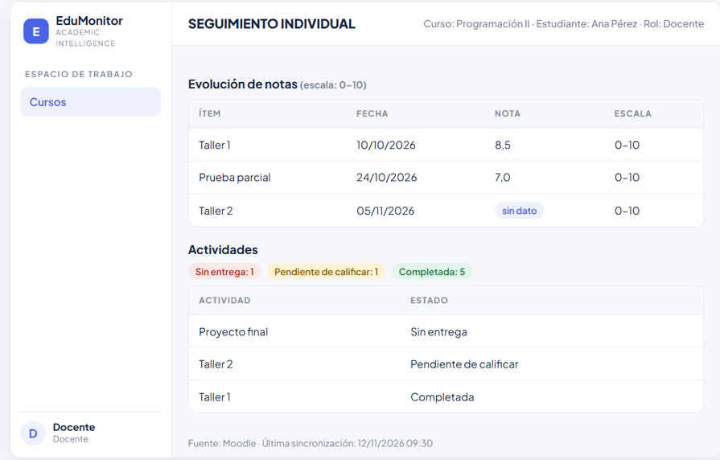

*Figura 1. Mockup M-07 — Seguimiento individual (HU-08)*

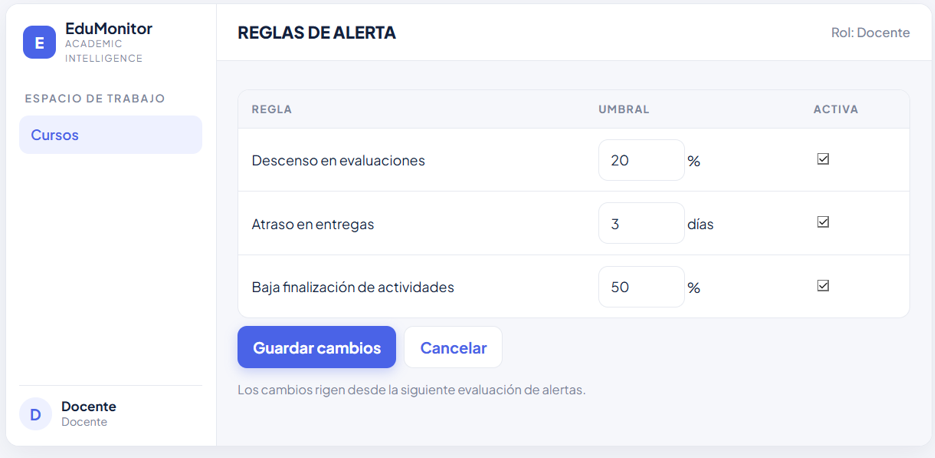

*Figura 2. Mockup M-08 — Reglas de alerta (HU-09)*

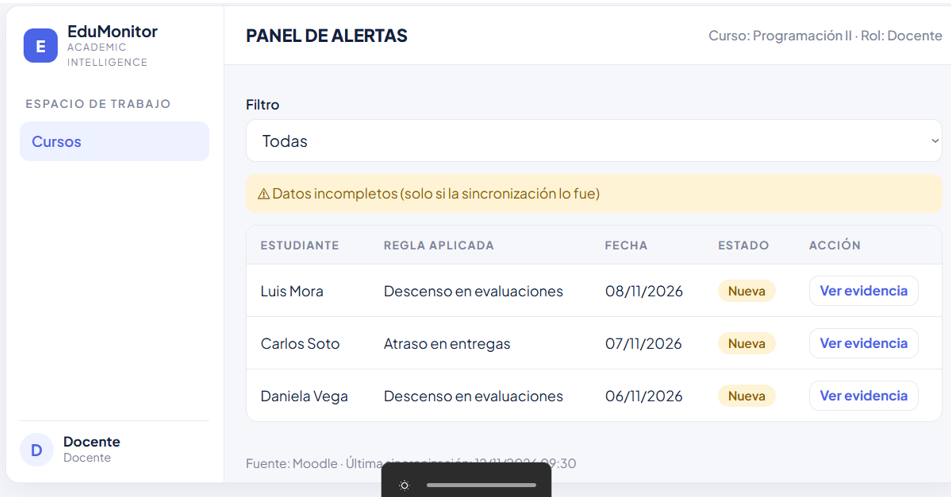

*Figura 3. Mockup M-09 — Panel de alertas (HU-09)*

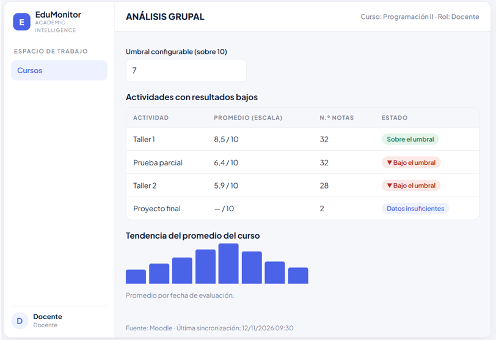

*Figura 4. Mockup M-10 — Análisis grupal (HU-10)*

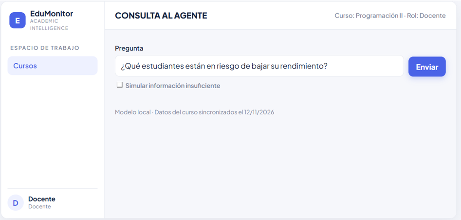

*Figura 5. Mockup M-11 — Consulta al agente (HU-11)*

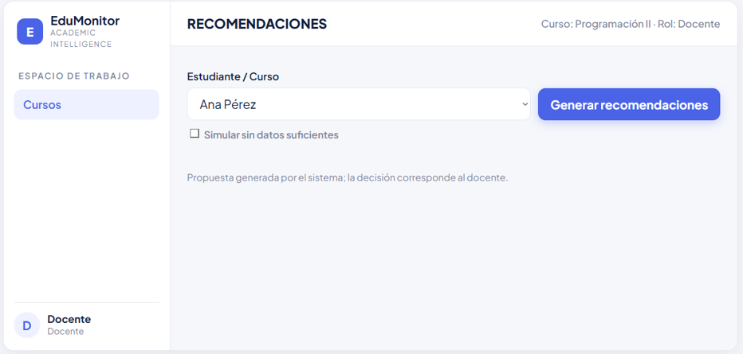

*Figura 6. Mockup M-12 — Recomendaciones (HU-12)*

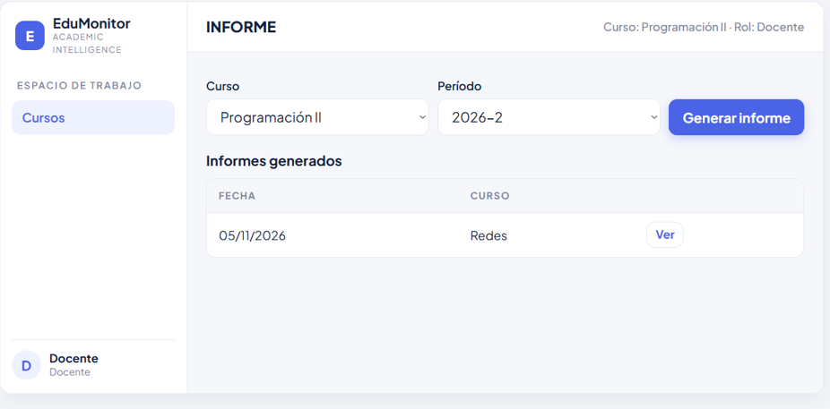

*Figura 7. Mockup M-13 — Informe (HU-13)*

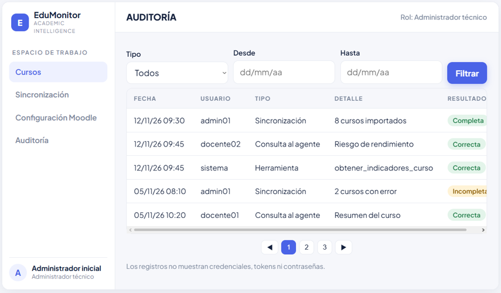

*Figura 8. Mockup M-14 — Consulta de auditoría (HU-14)*

---

# 14. CRITERIOS DE ACEPTACIÓN

| Historia | Criterio | Descripción |
|---|---|---|
| HU-08 | CA-08.1 | Dado un docente con un curso autorizado, cuando selecciona un estudiante, entonces ve la evolución de sus notas por ítem, ordenada por fecha y con la escala explícita. |
| HU-08 | CA-08.2 | Dadas las actividades del estudiante, cuando se listan, entonces cada una aparece clasificada como Sin entrega, Pendiente de calificar o Completada, sin mezclar los estados. |
| HU-08 | CA-08.3 | Dada una nota ausente en Moodle, cuando se muestra, entonces aparece como «sin dato» y no como cero. |
| HU-08 | CA-08.4 | Dado un docente sin autorización sobre el curso, cuando solicita el seguimiento por identificador directo, entonces el sistema responde 403. |
| HU-09 | CA-09.1 | Dado un docente, cuando modifica el umbral o el estado de una regla de alerta y guarda, entonces el cambio rige en la siguiente evaluación sin recompilar. |
| HU-09 | CA-09.2 | Dados datos sincronizados, cuando se evalúan las reglas, entonces se generan alertas por descenso en evaluaciones, por atraso y por baja finalización. |
| HU-09 | CA-09.3 | Dada una alerta, cuando se abre su detalle, entonces muestra la evidencia (ítems, valores, fechas y regla aplicada) y su texto no usa etiquetas definitivas sobre el estudiante. |
| HU-09 | CA-09.4 | Dada una sincronización incompleta, cuando se evalúan las reglas, entonces no se generan alertas basadas en datos faltantes y se informa al docente (RN-07). |
| HU-09 | CA-09.5 | Dado el panel de alertas, cuando se muestra, entonces indica la fuente y la fecha de la última sincronización (RN-09). |
| HU-10 | CA-10.1 | Dado un curso con datos sincronizados, cuando el docente abre el análisis grupal, entonces ve las actividades ordenadas por resultado promedio y resaltadas las que están bajo el umbral configurable. |
| HU-10 | CA-10.2 | Dado el análisis, cuando se muestra la tendencia, entonces se ve la evolución del promedio del curso por fecha de evaluación con su escala. |
| HU-10 | CA-10.3 | Dada una actividad con menos calificaciones que el mínimo definido, cuando se calcula su resultado, entonces se marca «datos insuficientes» y no se concluye sobre ella. |
| HU-10 | CA-10.4 | Dado cualquier resultado mostrado, cuando se observa el análisis, entonces indica la fuente y la fecha de la última sincronización. |
| HU-11 | CA-11.1 | Dada una pregunta sobre un curso autorizado, cuando el agente responde, entonces la respuesta se basa en datos obtenidos con herramientas controladas y no en información inventada. |
| HU-11 | CA-11.2 | Dada una respuesta, cuando se muestra, entonces distingue de forma explícita los hechos, las inferencias y las recomendaciones. |
| HU-11 | CA-11.3 | Dada una pregunta sin información suficiente, cuando el agente responde, entonces reconoce la incertidumbre y no inventa datos. |
| HU-11 | CA-11.4 | Dada una pregunta sobre un curso no autorizado, cuando el agente intenta consultar, entonces la herramienta rechaza el acceso y el agente lo informa. |
| HU-11 | CA-11.5 | Dada cualquier consulta, cuando se procesa, entonces el modelo se ejecuta localmente y no se envía información identificable a servicios externos. |
| HU-12 | CA-12.1 | Dado un estudiante o curso con alertas o indicadores, cuando el docente solicita recomendaciones, entonces se proponen acciones concretas indicando qué hacer y sobre qué actividad o tema. |
| HU-12 | CA-12.2 | Dada una recomendación, cuando se muestra, entonces incluye la justificación con los indicadores que la sustentan (valor, actividad y fecha). |
| HU-12 | CA-12.3 | Dada una recomendación propuesta, cuando el docente la revisa, entonces se identifica como propuesta del sistema y puede aceptarla, ajustarla o descartarla. |
| HU-12 | CA-12.4 | Dados datos insuficientes, cuando se solicitan recomendaciones, entonces no se generan y se explica el motivo. |
| HU-13 | CA-13.1 | Dado un curso y un período, cuando el docente genera el informe, entonces este incluye el período, las métricas, los hallazgos, las recomendaciones y la fecha de actualización de los datos. |
| HU-13 | CA-13.2 | Dado un informe generado, cuando el docente lo consulta, entonces puede verlo en el sistema y descargarlo en el formato acordado con el Product Owner. |
| HU-13 | CA-13.3 | Dado un curso con sincronización incompleta, cuando se genera el informe, entonces este indica expresamente que los datos están incompletos. |
| HU-13 | CA-13.4 | Dado un docente sin autorización sobre el curso, cuando solicita su informe, entonces el sistema responde 403. |
| HU-14 | CA-14.1 | Dada una sincronización, una consulta al agente o el uso de una herramienta, cuando ocurre, entonces se registra con el usuario, la fecha y el resultado. |
| HU-14 | CA-14.2 | Dado el registro de auditoría, cuando se revisa su contenido, entonces no incluye credenciales, tokens ni contraseñas. |
| HU-14 | CA-14.3 | Dado un administrador técnico, cuando filtra por tipo y por rango de fechas, entonces obtiene los registros coincidentes de forma paginada. |
| HU-14 | CA-14.4 | Dado un usuario con rol Docente, cuando intenta consultar el registro de auditoría, entonces el sistema responde 403. |

*Tabla 5. Criterios de aceptación del Sprint 2 (30 criterios)*

---

# 15. ESTIMACIÓN DE LAS HISTORIAS DE USUARIO

| Historia | Puntos de historia | Horas de tareas de diseño | Justificación |
|---|---|---|---|
| HU-08 | 5 SP | 5,0 h | Vista por estudiante con clasificación de estados; reutiliza los datos del Sprint 1. |
| HU-09 | 8 SP | 8,0 h | Reglas configurables, motor de evaluación, evidencias y estados. |
| HU-10 | 5 SP | 5,0 h | Cálculos grupales y tendencia, con umbral configurable. |
| HU-11 | 8 SP | 10,5 h | Mayor incertidumbre: agente con herramientas controladas y privacidad. |
| HU-12 | 5 SP | 5,0 h | Recomendaciones justificadas, dependientes de alertas e indicadores. |
| HU-13 | 5 SP | 5,0 h | Generación y descarga del informe con período y aviso de datos incompletos. |
| HU-14 | 3 SP | 4,0 h | Registro y consulta filtrada de auditoría. |
| Tareas habilitadoras | — | 8,0 h | Consolidación de modelos, trazabilidad, revisión del documento y presentación. |
| **Total** | **39 SP** | **50 h** | |

*Tabla 6. Estimación del Sprint 2*

---

# 16. DESCOMPOSICIÓN DE HISTORIAS DE USUARIO EN TAREAS

Cada historia se descompone en cuatro tareas: especificación (.1), mockup (.2), modelo y diseño técnico (.3) y casos de prueba (.4). HU-11 agrega la tarea 11.5. En total son 33 tareas, incluidas las cuatro tareas habilitadoras (TE-01 a TE-04).

| Tarea | Nombre | Responsable | Horas |
|---|---|---|---|
| TA-08.1 | Especificación de la historia y criterios | Quispe | 1,0 |
| TA-08.2 | Mockup M-07 Seguimiento individual | Redroban | 1,5 |
| TA-08.3 | Modelo y diseño técnico del seguimiento individual | Manobanda | 1,5 |
| TA-08.4 | Casos de prueba funcional de HU-08 | Quispe | 1,0 |
| TA-09.1 | Especificación de la historia y criterios | Quispe | 1,5 |
| TA-09.2 | Mockups M-08 y M-09 (reglas y panel de alertas) | Redroban | 2,5 |
| TA-09.3 | Modelo de datos y diseño del motor de reglas | Manobanda | 2,5 |
| TA-09.4 | Casos de prueba funcional de HU-09 | Quispe | 1,0 |
| TA-10.1 | Especificación de la historia y criterios | Curillo | 1,0 |
| TA-10.2 | Mockup M-10 Análisis grupal | Redroban | 1,5 |
| TA-10.3 | Modelo y diseño técnico del análisis grupal | Curillo | 1,5 |
| TA-10.4 | Casos de prueba funcional de HU-10 | Quispe | 1,0 |
| TA-11.1 | Especificación de la historia y criterios | Curillo | 1,5 |
| TA-11.2 | Mockup M-11 Consulta al agente | Redroban | 2,0 |
| TA-11.3 | Diseño de la arquitectura de los servicios de IA | Curillo | 3,5 |
| TA-11.4 | Modelo de datos y diagrama de secuencia del agente | Manobanda | 2,0 |
| TA-11.5 | Casos de prueba funcional de HU-11 | Quispe | 1,5 |
| TA-12.1 | Especificación de la historia y criterios | Quispe | 1,0 |
| TA-12.2 | Mockup M-12 Recomendaciones | Redroban | 1,5 |
| TA-12.3 | Modelo y diseño técnico de recomendaciones | Curillo | 1,5 |
| TA-12.4 | Casos de prueba funcional de HU-12 | Quispe | 1,0 |
| TA-13.1 | Especificación de la historia y criterios | Redroban | 1,0 |
| TA-13.2 | Mockup M-13 Informe | Redroban | 1,5 |
| TA-13.3 | Modelo y diseño técnico del informe | Manobanda | 1,5 |
| TA-13.4 | Casos de prueba funcional de HU-13 | Quispe | 1,0 |
| TA-14.1 | Especificación de la historia y criterios | Curillo | 0,5 |
| TA-14.2 | Mockup M-14 Consulta de auditoría | Redroban | 1,0 |
| TA-14.3 | Modelo y diseño técnico de auditoría | Manobanda | 1,5 |
| TA-14.4 | Casos de prueba funcional de HU-14 | Quispe | 1,0 |
| TE-01 | Modelo de datos y arquitectura ampliados (consolidación) | Manobanda | 2,5 |
| TE-02 | Matriz de trazabilidad y estrategia de pruebas funcionales | Quispe | 2,0 |
| TE-03 | Consolidación y revisión del documento de planificación | Curillo | 2,0 |
| TE-04 | Preparación y ensayo de la presentación del Sprint 2 | Redroban | 1,5 |

*Tabla 7. Descomposición en tareas del Sprint 2*

---

# 17. SPRINT BACKLOG

## 17.1 Tablero Scrum (estado inicial)

| Historia | Por hacer | En progreso | Hecho |
|---|---|---|---|
| HU-08 (5 SP) | TA-08.1 a TA-08.4 | — | — |
| HU-09 (8 SP) | TA-09.1 a TA-09.4 | — | — |
| HU-10 (5 SP) | TA-10.1 a TA-10.4 | — | — |
| HU-11 (8 SP) | TA-11.1 a TA-11.5 | — | — |
| HU-12 (5 SP) | TA-12.1 a TA-12.4 | — | — |
| HU-13 (5 SP) | TA-13.1 a TA-13.4 | — | — |
| HU-14 (3 SP) | TA-14.1 a TA-14.4 | — | — |
| Habilitadoras | TE-01 a TE-04 | — | — |

## 17.2 Resumen del Sprint Backlog

| Concepto | Valor |
|---|---|
| Historias de Usuario | 7 |
| Puntos de historia | 39 SP |
| Tareas | 33 |
| Horas planificadas | 50 h |
| Capacidad neta | 72 h |
| Holgura | 22 h |

*Tabla 8. Resumen del Sprint Backlog*

---

# 18. DISTRIBUCIÓN DE RESPONSABILIDADES

| Integrante | Tareas asignadas | Horas |
|---|---|---|
| Curillo Pilamunga Diego Alexander | TA-10.1, 10.3, 11.1, 11.3, 12.3, 14.1, TE-03 | 13,0 |
| Manobanda Masabanda Luis Alfredo | TA-08.3, 09.3, 11.4, 13.3, 14.3, TE-01 | 11,5 |
| Redroban Chimbo Joselyn Amparo | TA-08.2, 09.2, 10.2, 11.2, 12.2, 13.1, 13.2, 14.2, TE-04 | 12,5 |
| Quispe Nasimba Daniela Alejandra | TA-08.1, 08.4, 09.1, 09.4, 10.4, 11.5, 12.1, 12.4, 13.4, 14.4, TE-02 | 13,0 |

*Tabla 9. Distribución de responsabilidades*

---

# 19. PLAN DE TRABAJO DEL SPRINT 2

## 19.1 Orden de elaboración y dependencias

1. **Especificación primero (05/11):** las tareas .1 desbloquean mockups, modelos y casos de prueba.
2. **Diseño en paralelo (05/11 al 09/11):** el diseño del servicio de IA (TA-11.3) inicia el primer día por ser el de mayor riesgo.
3. **Dependencias funcionales:** HU-08 y HU-10 alimentan las herramientas del agente (HU-11); HU-09 y HU-11 alimentan las recomendaciones (HU-12); HU-12 y HU-10 alimentan el informe (HU-13); HU-09, HU-11 y la sincronización alimentan la auditoría (HU-14).
4. **Casos de prueba después de los mockups.**
5. **Consolidación (09/11 y 10/11):** TE-01, TE-02 y TE-03; entrega el 10/11/2026.
6. **Presentación (11/11 y 12/11):** TE-04; presentación el 12/11/2026.

## 19.2 Cronograma por integrante

| Fecha | Curillo | Manobanda | Redroban | Quispe |
|---|---|---|---|---|
| 05/11 | TA-10.1, TA-11.1, TA-11.3 (inicio) | TA-08.3 | TA-08.2, TA-13.1 | TA-08.1, TA-09.1 |
| 06/11 | TA-11.3, TA-10.3 | TA-09.3 | TA-09.2, TA-10.2 | TA-08.4, TA-12.1 |
| 09/11 | TA-12.3, TA-14.1 | TA-11.4, TA-13.3 | TA-11.2, TA-12.2, TA-13.2 | TA-09.4, TA-10.4, TA-11.5 |
| 10/11 | TE-03 | TA-14.3, TE-01 | TA-14.2 | TA-12.4, TA-13.4, TA-14.4, TE-02 |
| 11/11 | Ajustes finales | Ajustes finales | TE-04 | Ajustes finales |
| 12/11 | Presentación | Presentación | Presentación | Presentación |

El cronograma diario por tarea, con fechas de inicio y fin, se detalla en la sección 16.2 de `Planificacion_Sprint2_AcademIA.md`. Este cuadro es un resumen de la distribución prevista.

## 19.3 Riesgos e impedimentos

| N.º | Riesgo o impedimento | Probabilidad | Medida de mitigación |
|---|---|---|---|
| 1 | Plazo corto hasta la entrega del 10/11 | Alta | Trabajar en paralelo y usar la holgura de 22 h. |
| 2 | Definiciones pendientes del Product Owner | Media | Plantear las preguntas en la reunión y registrar supuestos. |
| 3 | Complejidad del diseño del agente de IA | Media | Iniciar TA-11.3 el 05/11 y limitar las herramientas a solo lectura. |
| 4 | Inconsistencias entre historias, mockups, modelos y pruebas | Media | Matriz de trazabilidad (TE-02) y revisión en TE-03. |
| 5 | Resultados del Sprint 1 aún no consolidados | Media | Basar los diseños en el modelo previsto y ajustar al cierre. |
| 6 | Datos reales de Moodle insuficientes para los casos de prueba | Media | Casos con datos anonimizados y umbrales configurables. |
| 7 | Coordinación del equipo y revisión del PO a tiempo | Media | Reunión diaria y revisión el 10/11. |
| 8 | Ambigüedad en las fechas de inicio | Baja | Confirmar con el PO; el plan usa 04/11. |

*Tabla 10. Riesgos e impedimentos del Sprint 2*

## 19.4 Criterios de finalización del Sprint 2

- Las siete Historias de Usuario tienen ficha, criterios verificables, mockup, modelo, diseño técnico y casos de prueba.
- La matriz de trazabilidad no deja criterios sin caso de prueba (30 criterios y 30 casos).
- El modelo de datos y la arquitectura ampliados son coherentes con el Sprint 1 y con las historias.
- El Product Owner recibe la planificación el 10/11/2026 y valida el paquete.
- El equipo presenta el Sprint 2 el 12/11/2026.
- Las tareas están cerradas en el tablero Scrum.

---

# 20. DEFINICIÓN DE TERMINADO (DEFINITION OF DONE)

**Una tarea se considera terminada cuando:**

1. Se implementó o elaboró de acuerdo con su descripción y con el requerimiento relacionado.
2. El trabajo está integrado en el repositorio Git mediante un Pull Request hacia `develop`.
3. Compila sin errores y se ejecuta en el entorno local de desarrollo (cuando se trata de código).
4. Maneja los errores previstos con mensajes útiles y sin exponer información sensible.
5. No contiene secretos en el código ni en el repositorio (RN-04, RNF-01).
6. Está actualizada en el tablero Scrum.

**Una Historia de Usuario se considera completamente terminada cuando:**

1. Todas sus tareas cumplen la Definición de Terminado de tarea.
2. Cumple todos sus criterios de aceptación (sección 14), verificados con los casos de prueba (sección 24).
3. Respeta las reglas de negocio aplicables (sección 5.3) y los requerimientos no funcionales relacionados.
4. Se puede demostrar funcionando de extremo a extremo al Product Owner, y este la valida.

---

# 21. COMPROMISO DEL EQUIPO

El equipo de desarrollo, conformado por Curillo Pilamunga Diego Alexander, Manobanda Masabanda Luis Alfredo, Redroban Chimbo Joselyn Amparo y Quispe Nasimba Daniela Alejandra, se compromete a completar las siete Historias de Usuario del Sprint 2 (39 puntos de historia y 50 horas de trabajo estimado), a entregar la planificación el 10/11/2026 y a presentar el Sprint el 12/11/2026.

Este compromiso se definió con el Product Owner, Ing. Hernán Naranjo, Mg., en la reunión del 04/11/2026, se basa en la capacidad del equipo (72 horas netas frente a 50 planificadas) y mantiene el alcance durante el Sprint; cualquier cambio se gestiona con el Product Owner.

| Integrante | Compromiso |
|---|---|
| Curillo Pilamunga Diego Alexander | ☐ Aceptado |
| Manobanda Masabanda Luis Alfredo | ☐ Aceptado |
| Redroban Chimbo Joselyn Amparo | ☐ Aceptado |
| Quispe Nasimba Daniela Alejandra | ☐ Aceptado |
| Ing. Hernán Naranjo, Mg. (Product Owner) | ☐ Conforme con el alcance |

*Tabla 11. Compromiso del equipo*

---

# 22. CONCLUSIONES DE LA PLANIFICACIÓN

1. **Un Sprint de diseño reduce el riesgo.** Especificar RF-06 a RF-12 antes de construirlos resolvió ambigüedades, sobre todo en el agente de IA.
2. **Trazabilidad completa.** Cada criterio de aceptación tiene un caso de prueba y está ligado a una historia, un mockup y un modelo.
3. **Privacidad y control de acceso desde el diseño.** Las reglas RN-18 y RN-19 y las herramientas de solo lectura del agente cumplen RNF-01 y RNF-02.
4. **Distribución equilibrada.** Las 33 tareas se reparten entre los cuatro integrantes (11,5 a 13 horas cada uno).
5. **Planificación realista.** 50 horas planificadas sobre 72 netas dejan 22 horas de holgura.
6. **Valor del incremento.** El proyecto dispone de un paquete de especificación y diseño listo para construirse; el equipo adelantó además su implementación.

---

# 23. RESULTADOS DEL SPRINT 2

Las secciones 23 a 27 corresponden al cierre del Sprint 2 (04/11/2026 – 12/11/2026). Los estados se basan en el código integrado en `develop` y en las pruebas ejecutadas; lo que no cuenta con evidencia se marca como pendiente y no como fallido.

**Pull Requests integrados en `develop`:** #13 (HU-10, HU-11, HU-12, HU-14 y agente de IA, Diego Curillo), #14 (HU-08), #15 (HU-09) y #16 (HU-13). Los ajustes de auditoría y las pruebas funcionales quedan en la rama `fix/joselyn-auditoria-pruebas`.

## 23.1 HU-08 – Seguimiento individual de un estudiante

**Objetivo:** Mostrar al docente la evolución de las notas de un estudiante y el estado de sus actividades.

| Funcionalidad | Tarea | Estado |
|---|---|---|
| Mockup M-07 | TA-08.2 | Entregado |
| Endpoint `GET /api/cursos/{cursoId}/estudiantes/{estudianteId}/seguimiento` con autorización por curso | — | Implementado y probado |
| Pantalla `FichaEstudiante` (notas con escala, estados de actividad, «sin dato» y fecha de sincronización) | — | Implementada y probada por API; verificada su compilación |
| Correcciones: no mostrar fechas anteriores al año 2000 | — | Corregido (defecto D-01) |

**Tecnologías:** React.js (`FichaEstudiante.jsx`), Middleware .NET 10 y servicio de Análisis, con la proyección del curso en SQL Server.

**Descripción de lo construido:** Al hacer clic en un estudiante del curso se abre su ficha con las notas ordenadas por fecha y su escala, las actividades clasificadas en Sin entrega, Pendiente de calificar y Completada, y la fuente y fecha de la última sincronización. Una nota ausente se muestra como «sin dato». Moodle envía `dateSubmitted = "1"` como marcador en actividades sin calificar, por lo que la ficha omite fechas anteriores al año 2000.

## 23.2 HU-09 – Reglas y alertas académicas

**Objetivo:** Permitir al docente configurar reglas de alerta y consultar las alertas con su evidencia.

| Funcionalidad | Tarea | Estado |
|---|---|---|
| Mockups M-08 y M-09 | TA-09.2 | Entregados |
| Reglas configurables (descenso, atraso y baja finalización) con umbrales por defecto de 20 %, 3 días y 50 % | — | Implementadas y probadas |
| Motor de evaluación (`AlertEvaluator`) con evidencia por alerta | — | Implementado y probado |
| Estados de alerta (Activa, Revisada, Descartada) con filtro | — | Implementados y probados |
| Pantallas `ReglasAlerta` y `AlertasCurso` | — | Implementadas; verificada su compilación |
| Tablas `ALERT_RULE` y `ALERT_STATE` (script `009_analysis_alerts.sql`) | TA-09.3 | Implementadas |

**Descripción de lo construido:** El servicio de Análisis evalúa las reglas del curso sobre la proyección sincronizada y genera alertas con su evidencia (ítem, valor, fecha y regla). Un umbral inválido (por ejemplo `0`) se rechaza con HTTP 400. Si la sincronización está «Incompleta», no se generan alertas por datos faltantes y se muestra un aviso. Los textos de las alertas evitan etiquetas definitivas («Se recomienda revisar el contexto antes de actuar»).

## 23.3 HU-10 – Análisis grupal del curso

| Funcionalidad | Tarea | Estado |
|---|---|---|
| Mockup M-10 | TA-10.2 | Entregado |
| Componente `GroupAnalysisPanel` en el dashboard del curso | — | Implementado (PR #13); pendiente prueba funcional |
| Cálculo del análisis grupal en el servicio de Análisis | TA-10.3 | Implementado (PR #13); pendiente prueba funcional |

## 23.4 HU-11 – Agente de IA

| Funcionalidad | Tarea | Estado |
|---|---|---|
| Mockup M-11 | TA-11.2 | Entregado |
| Componente `CourseAssistantPanel` | — | Implementado (PR #13); pendiente prueba funcional |
| Servicio del agente (Python / FastAPI, puerto 8010) con herramientas de solo lectura | TA-11.3 | Implementado (PR #13); pendiente prueba funcional |

La verificación de los criterios CA-11.1 a CA-11.5 (en particular la ejecución local del modelo y el rechazo de cursos no autorizados) permanece pendiente de evidencia.

## 23.5 HU-12 – Recomendaciones pedagógicas

| Funcionalidad | Tarea | Estado |
|---|---|---|
| Mockup M-12 | TA-12.2 | Entregado |
| Componente `RecommendationsPanel` y script `008_analysis_recommendations.sql` | TA-12.3 | Implementado (PR #13); pendiente prueba funcional |

## 23.6 HU-13 – Informe del curso

**Objetivo:** Generar, consultar y descargar un informe resumen del curso.

| Funcionalidad | Tarea | Estado |
|---|---|---|
| Mockup M-13 | TA-13.2 | Entregado |
| Generación del informe con período, indicadores, hallazgos, recomendaciones y fecha de actualización | TA-13.1 | Implementada y probada |
| Listado, vista y descarga (HTML imprimible; PDF mediante «Imprimir») | — | Implementados y probados |
| Aviso de datos incompletos y respuesta 403 sin autorización | — | Implementados y probados |
| Pantalla `InformesCurso` y tabla `ACADEMIC_REPORT` (script `010_analysis_reports.sql`) | TA-13.3 | Implementadas |

**Nota:** el formato de descarga (HTML imprimible) debe confirmarse con el Product Owner (CA-13.2).

## 23.7 HU-14 – Registro de auditoría

| Funcionalidad | Tarea | Estado |
|---|---|---|
| Mockup M-14 | TA-14.2 | Entregado |
| Pantalla `Auditoria` (`/admin/auditoria`) y tabla `AUDIT_LOG` (script `007_sprint2_audit.sql`) | TA-14.3 | Implementadas (PR #13) |
| Filtro ampliado con los eventos `ReglasAlertaActualizadas`, `EstadoAlertaActualizado`, `InformeGenerado` e `InformeDescargado`; el backend ya los acepta (antes respondía 400) | — | Corregido en la rama `fix/joselyn-auditoria-pruebas` |

Los eventos de HU-09 y HU-13 se registraron en la auditoría durante las pruebas. La verificación de los criterios CA-14.1 a CA-14.4 de forma independiente permanece pendiente de evidencia.

## 23.8 Verificación de compilación y entorno

- `dotnet build` del Middleware: 0 errores.
- `npm run build` del frontend: compila sin errores.
- Los scripts SQL `001` a `010` son idempotentes; la guía de levantamiento se encuentra en `docs/Guia_Levantar_Proyecto.md`.

---

# 24. TESTING DE LAS HISTORIAS DE USUARIO

La planificación define 30 casos de prueba funcional (uno por criterio de aceptación). En este Sprint se ejecutaron **13 casos** (HU-08, HU-09 y HU-13), todos **Aprobados**. Los 17 casos restantes (HU-10, HU-11, HU-12 y HU-14) permanecen **pendientes de evidencia**; no se consideran fallidos. El detalle completo de la ejecución se encuentra en `Pruebas_Funcionales_Sprint2.md`.

**Método.** Se levantaron el servicio de Análisis (5030) y el Middleware (5000) con SQL Server Express y RabbitMQ locales, y se llamó a los endpoints con tokens JWT firmados con la clave de la sesión de pruebas (Docente con `course_id` 1001 y 9001, Docente B con `course_id` 999 y Administrador técnico). El frontend se verificó con `npm run build`. No se realizó un recorrido visual documentado en el navegador ni se tomaron capturas; no se ejecutó una suite automatizada. HU-08 y los casos 403 usaron el curso real 1001; HU-09 y HU-13 usaron un curso temporal (9001) con cuatro estudiantes sintéticos que fue eliminado al terminar.

## 24.1 HU-08 – Seguimiento individual

| Caso | Entrada | Resultado esperado | Resultado obtenido |
|---|---|---|---|
| CP-08.1 | Ficha de un estudiante con notas | Notas ordenadas por fecha con su escala | Aprobado: 3 notas (78, 91, 82) con escala 0–100, ordenadas por fecha |
| CP-08.2 | Ficha con actividades en los tres estados | Cada actividad en su estado, sin mezclar | Aprobado: `Completada`, `PendienteCalificar` y `SinEntrega` |
| CP-08.3 | Actividad sin calificar | «sin dato», no cero | Aprobado: `nota: null` mostrada como «sin dato» (defecto D-01 corregido) |
| CP-08.4 | Docente B sin asignación | HTTP 403 | Aprobado: HTTP 403 |

## 24.2 HU-09 – Reglas y alertas

| Caso | Entrada | Resultado esperado | Resultado obtenido |
|---|---|---|---|
| CP-09.1 | Cambiar el umbral de Descenso de 20 a 50 y volver a 20 | El cambio rige sin recompilar y persiste | Aprobado; umbral `0` → HTTP 400 |
| CP-09.2 | Curso con descenso, atraso y baja finalización conocidos | Las tres alertas esperadas y ninguna otra | Aprobado: `Descenso`, `Atraso` y `BajaFinalizacion`; el alumno regular sin alertas |
| CP-09.3 | Abrir la evidencia de una alerta | Ítems, valores, fechas, regla y texto sin etiquetas definitivas | Aprobado |
| CP-09.4 | Sincronización «Incompleta» | Sin alertas por datos faltantes y con aviso | Aprobado: 0 alertas y `datosIncompletos = true` |
| CP-09.5 | Pie del panel | Fuente y fecha de la última sincronización | Aprobado: `fuente = "Moodle"` y fecha UTC |

## 24.3 HU-10 – Análisis grupal

| Caso | Resultado |
|---|---|
| CP-10.1 a CP-10.4 | Pendiente de evidencia del equipo |

## 24.4 HU-11 – Agente de IA

| Caso | Resultado |
|---|---|
| CP-11.1 a CP-11.5 | Pendiente de evidencia del equipo |

## 24.5 HU-12 – Recomendaciones

| Caso | Resultado |
|---|---|
| CP-12.1 a CP-12.4 | Pendiente de evidencia del equipo |

## 24.6 HU-13 – Informe del curso

| Caso | Entrada | Resultado esperado | Resultado obtenido |
|---|---|---|---|
| CP-13.1 | Generar el informe de un curso | Período, métricas, hallazgos, recomendaciones y fecha de actualización | Aprobado |
| CP-13.2 | Ver y descargar | Visualización y descarga | Aprobado: descarga 200, `text/html`, `Content-Disposition: attachment` |
| CP-13.3 | Curso con sincronización incompleta | Aviso de datos incompletos | Aprobado: `datosIncompletos = true` y aviso |
| CP-13.4 | Docente B sin asignación | HTTP 403 | Aprobado: HTTP 403 |

## 24.7 HU-14 – Auditoría

| Caso | Resultado |
|---|---|
| CP-14.1 a CP-14.4 | Pendiente de evidencia del equipo. Evidencia parcial: durante las pruebas se registraron `ReglasAlertaActualizadas` (Éxito y Error), `EstadoAlertaActualizado`, `InformeGenerado` e `InformeDescargado`. |

## 24.8 Defectos encontrados

| ID | Caso | Descripción | Severidad | Estado |
|---|---|---|---|---|
| D-01 | CP-08.3 | La ficha mostraba `01/01/1970` en una nota sin calificar, porque Moodle envía `dateSubmitted = "1"` como marcador. | Baja | Corregido en `FichaEstudiante.jsx` |
| D-02 | HU-14 | El filtro de Auditoría no incluía los eventos de HU-09 y HU-13 y el backend los rechazaba con 400. | Baja | Corregido en `Auditoria.jsx` y `AuditoriaController.cs` |

---

# 25. DIAGRAMAS

Se presentan los diagramas actualizados en PlantUML, que puede renderizarse en cualquier editor compatible. Los diagramas gráficos del Sprint 1 se encuentran en `docs/diagramas/`; las versiones actualizadas de Luis Manobanda (TE-01) deben insertarse como imagen en la versión final de este informe si difieren de los siguientes.

## 25.1 Arquitectura actualizada

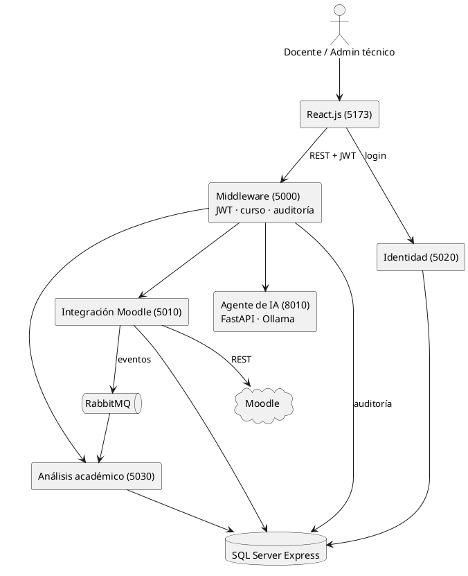

*Figura 9. Arquitectura actualizada del Sprint 2*

## 25.2 Modelo de datos actualizado

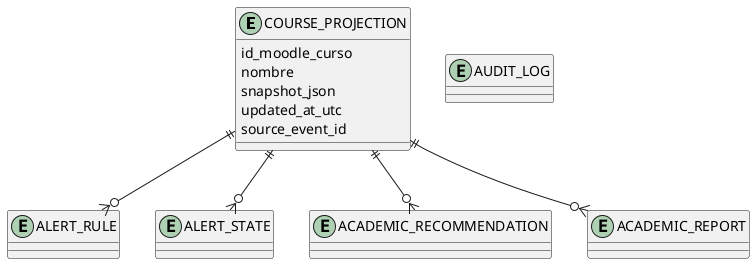

*Figura 10. Entidades nuevas del Sprint 2 (`ALERT_RULE`, `ALERT_STATE`, `ACADEMIC_RECOMMENDATION`, `ACADEMIC_REPORT`, `AUDIT_LOG`)*

## 25.3 Secuencia: evaluación de alertas

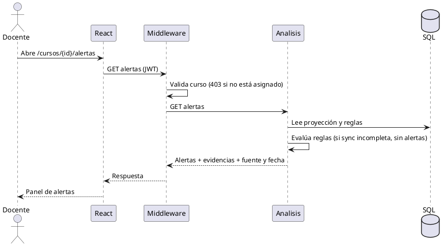

*Figura 11. Secuencia de la evaluación de alertas*

## 25.4 Secuencia: generación y descarga de informe

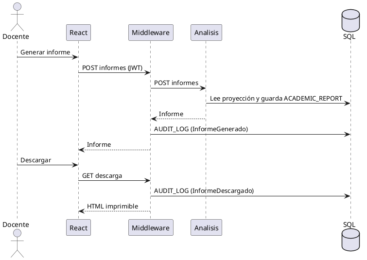

*Figura 12. Secuencia de generación y descarga de un informe*

---

# 26. RETROSPECTIVA DEL SPRINT 2

La retrospectiva recoge los riesgos de la planificación y los hechos observados durante el desarrollo. Las respuestas de la reunión de retrospectiva con el equipo y el Product Owner deben confirmarse antes de la entrega.

## 26.1 Problemas encontrados

| N.º | Riesgo considerado | ¿Se presentó? | Cómo se gestionó |
|---|---|---|---|
| 1 | Plazo corto hasta la entrega del 10/11 | Sí | Se trabajó por historias en ramas independientes y se priorizó el código de HU-08, HU-09 y HU-13. |
| 2 | Definiciones pendientes del Product Owner | Sí | El formato de descarga del informe (HTML imprimible) está pendiente de confirmar con el PO. |
| 3 | Complejidad del agente de IA | **[Completar con el equipo]** | La verificación del agente permanece pendiente. |
| 4 | Inconsistencias entre historias, mockups, modelos y pruebas | Sí | Se detectó el filtro de auditoría desalineado con los eventos de HU-09 y HU-13 (D-02) y se corrigió. |
| 5 | Resultados del Sprint 1 aún no consolidados | **[Completar con el equipo]** | — |
| 6 | Datos reales de Moodle insuficientes | Sí | Se creó un curso temporal con cuatro estudiantes sintéticos para las pruebas de alertas e informes. |
| 7 | Coordinación y revisión del PO a tiempo | **[Completar con el equipo]** | — |
| 8 | Ambigüedad en las fechas de inicio | **[Completar con el equipo]** | — |

**Otros problemas no previstos:**

- Cambio de alcance: el Sprint se planificó sin código y se decidió implementar, lo que no estaba en el compromiso ni en las 50 horas estimadas.
- Conflictos de integración entre las ramas de HU-13 y `develop` (`AnalysisDbContext.cs`, `App.jsx` y `DashboardCurso.jsx`), resueltos antes del merge.
- Moodle envía `dateSubmitted = "1"` como marcador, lo que mostraba `01/01/1970` (D-01).
- Las bases de datos locales debían crearse con los scripts `001` a `010`; algunas no existían en el SQL Server de ciertos equipos.
- No hay pruebas automatizadas ni evidencia gráfica (capturas) de la ejecución.

## 26.2 Aspectos positivos del Sprint

- El flujo de trabajo en Git (rama por historia desde `develop`, verificación local y Pull Request) permitió integrar HU-08, HU-09 y HU-13 sin romper lo existente.
- Las pruebas funcionales se ejecutaron realmente (13 de 13 aprobadas) y permitieron detectar y corregir dos defectos.
- La autorización por curso (403) se verificó de forma consistente en seguimiento, alertas e informes.
- Los scripts SQL idempotentes facilitan reproducir el entorno.

## 26.3 Reflexiones del equipo

El Sprint 2 pasó de un paquete de especificación y diseño a un incremento funcional: el docente puede consultar el seguimiento de un estudiante, configurar reglas y revisar alertas con su evidencia, y generar y descargar informes del curso; además, el equipo implementó el análisis grupal, el agente de IA, las recomendaciones y la auditoría. La principal enseñanza es que avanzar la implementación exige ampliar de manera explícita el plan de pruebas: las historias HU-10, HU-11, HU-12 y HU-14 requieren aún su verificación funcional. **[Completar con la reflexión del equipo.]**

## 26.4 Mejoras propuestas

| Propuesta | Objetivo |
|---|---|
| Ejecutar las pruebas funcionales de HU-10, HU-11, HU-12 y HU-14 y adjuntar capturas. | Cerrar la cobertura de los 30 casos de prueba. |
| Incorporar pruebas automatizadas (unitarias y de integración) de las reglas de alerta y de autorización. | Garantizar resultados reproducibles (RNF-06). |
| Confirmar con el Product Owner el formato de descarga del informe y los umbrales por defecto. | Evitar retrabajo en el Sprint 3. |
| Insertar los diagramas actualizados de TE-01 y la presentación (TE-04) en la versión final. | Mantener la documentación alineada con lo implementado. |

---

# 27. MÉTRICAS Y CONCLUSIÓN

## 27.1 Métricas del Sprint 2

| Métrica | Planificado | Resultado real | % Cumplimiento |
|---|---|---|---|
| Historias de Usuario con diseño y mockup entregados | 7 | 7 (mockups M-07 a M-14 entregados) | 100 % |
| Historias de Usuario implementadas e integradas en `develop` | 0 (no estaba en el alcance) | 7 (PR #13, #14, #15 y #16) | — |
| Historias con pruebas funcionales ejecutadas y aprobadas | — | 3 (HU-08, HU-09 y HU-13) | 3 de 7 |
| Puntos de historia con implementación verificada por pruebas | 39 SP | 18 SP (HU-08: 5, HU-09: 8, HU-13: 5) | 46 % |
| Tareas completadas | 33 | **[Completar con el tablero]** | **[Completar]** |
| Horas de trabajo | 50 h (capacidad neta 72 h) | **[Completar con los registros del equipo]** | **[Completar]** |
| Criterios de aceptación | 30 | 13 verificados con prueba ejecutada | 43 % |
| Casos de prueba exitosos | 30 | 13 aprobados, 0 fallidos y 17 pendientes | 43 % |
| Defectos encontrados y corregidos | — | 2 encontrados, 2 corregidos | 100 % |

*Tabla 12. Métricas del Sprint 2*

## 27.2 Análisis de cumplimiento

El compromiso original (paquete de especificación y diseño) se cumplió en lo que respecta a los mockups M-07 a M-14 y a las historias definidas; los demás entregables (modelos, matriz de trazabilidad y presentación) dependen de las tareas de Luis Manobanda, Daniela Quispe y Diego Curillo, que deben confirmarse con el tablero. La ampliación voluntaria llevó a todas las historias a `develop`, pero solo 13 de los 30 casos de prueba cuentan con evidencia; los 17 restantes (HU-10, HU-11, HU-12 y HU-14) son la brecha principal. Los puntos y las horas reales deben completarse con el tablero Scrum.

## 27.3 Conclusión del Sprint 2

El Sprint 2 superó el alcance planificado: además de la especificación y el diseño de RF-06 a RF-12, el equipo implementó las siete historias en React y .NET y verificó funcionalmente HU-08 (seguimiento individual), HU-09 (reglas y alertas) y HU-13 (informes) con 13 casos aprobados y dos defectos corregidos. Quedan como base para el Sprint 3 la verificación de HU-10, HU-11, HU-12 y HU-14, la confirmación del formato del informe con el Product Owner, las pruebas automatizadas y la validación de las respuestas del agente de IA (hechos, inferencias, incertidumbre, privacidad y control de acceso).
