# Modelos y diagramas del Sprint 2

**Responsable:** Manobanda Masabanda Luis Alfredo  
**Colaborador de diseño:** Curillo Pilamunga Diego Alexander  
**Tareas:** TA-08.3, TA-09.3, TA-11.4, TA-13.3, TA-14.3 y TE-01

Los diagramas describen el modelo que quedó en el repositorio. Las tablas nuevas del Sprint 2 viven en `EduMonitorAnalysis`, salvo `AUDIT_LOG`, que vive en `EduMonitor`. El vínculo con `CURSO` y `ACTIVIDAD` es lógico por `id_moodle` / `id_moodle_curso`: no hay clave foránea entre bases de datos.

Hay cuatro diagramas distintos:

- `docs/diagramas/modelo-er.png`: modelo núcleo del Sprint 1.
- `docs/diagramas/modelo-er-sprint2.png`: entidad-relación ampliado, con alertas, informe, recomendaciones y auditoría.
- `docs/diagramas/arquitectura.png`: arquitectura general, con los paquetes de sistema externo, backend y frontend.
- `docs/diagramas/arquitectura-sprint2.png`: arquitectura de componentes del Sprint 2. Es la figura de esta sección.

## TE-01 — Modelo de datos y arquitectura ampliados

### Arquitectura de componentes

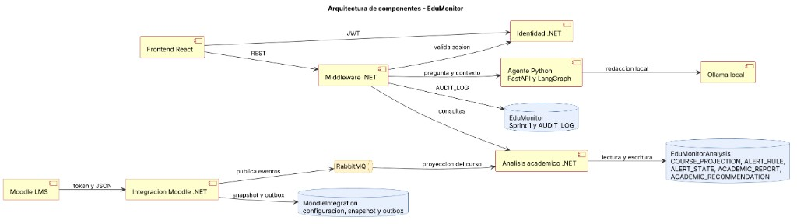

El docente no habla con Análisis ni con el agente de forma directa. Middleware valida el curso del JWT y reenvía la consulta. El agente no abre SQL Server: redacta con los indicadores y el análisis grupal que Middleware ya obtuvo. Ollama permanece en la red local del proyecto.

### Modelo entidad-relación ampliado

`COURSE_PROJECTION` guarda el snapshot sincronizado. De ese snapshot se calculan el seguimiento individual y las alertas. `ALERT_RULE` y `ALERT_STATE` guardan la configuración y el estado pedagógico. `ACADEMIC_REPORT` y `ACADEMIC_RECOMMENDATION` guardan el informe y las propuestas. La evidencia de una alerta no es una tabla: se arma al consultar el snapshot.

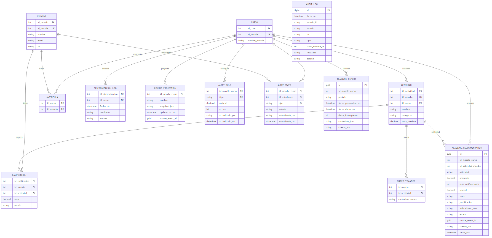

Esas dos figuras salen de PlantUML. Los diagramas de clases y de secuencia de cada tarea siguen en este documento.

### Diccionario de las tablas nuevas

| Tabla | Base | Columna | Tipo | Descripción |
|---|---|---|---|---|
| ALERT_RULE | EduMonitorAnalysis | id_moodle_curso | INT, PK | Curso de Moodle. |
| ALERT_RULE | EduMonitorAnalysis | tipo | NVARCHAR(30), PK | `Descenso`, `Atraso` o `BajaFinalizacion`. |
| ALERT_RULE | EduMonitorAnalysis | umbral | DECIMAL(6,2) | Umbral mayor que cero. En atraso son días; en los otros tipos, porcentaje. |
| ALERT_RULE | EduMonitorAnalysis | activa | BIT | Si la regla participa en la siguiente evaluación. |
| ALERT_RULE | EduMonitorAnalysis | actualizado_por | NVARCHAR(200) | Actor que guardó el cambio. |
| ALERT_RULE | EduMonitorAnalysis | actualizado_utc | DATETIME2 | Momento del cambio. Rige sin recompilar. |
| ALERT_STATE | EduMonitorAnalysis | id_moodle_curso | INT, PK | Curso de Moodle. |
| ALERT_STATE | EduMonitorAnalysis | id_estudiante | INT, PK | Identificador del estudiante en Moodle. |
| ALERT_STATE | EduMonitorAnalysis | tipo | NVARCHAR(30), PK | Misma lista que `ALERT_RULE.tipo`. |
| ALERT_STATE | EduMonitorAnalysis | estado | NVARCHAR(20) | `Nueva`, `Revisada` o `Descartada`. |
| ALERT_STATE | EduMonitorAnalysis | actualizado_por | NVARCHAR(200) | Docente que cambió el estado. |
| ALERT_STATE | EduMonitorAnalysis | actualizado_utc | DATETIME2 | Momento del cambio de estado. |
| ACADEMIC_REPORT | EduMonitorAnalysis | id | UNIQUEIDENTIFIER, PK | Informe generado. |
| ACADEMIC_REPORT | EduMonitorAnalysis | id_moodle_curso | INT | Curso. Índice con la fecha de generación. |
| ACADEMIC_REPORT | EduMonitorAnalysis | periodo | NVARCHAR(150) | Período indicado o el período activo del curso. |
| ACADEMIC_REPORT | EduMonitorAnalysis | fecha_generacion_utc | DATETIME2 | Cuándo se generó. |
| ACADEMIC_REPORT | EduMonitorAnalysis | fecha_datos_utc | DATETIME2 | Fecha del snapshot usado. |
| ACADEMIC_REPORT | EduMonitorAnalysis | datos_incompletos | BIT | Verdadero si la sincronización no está completa. |
| ACADEMIC_REPORT | EduMonitorAnalysis | contenido_json | NVARCHAR(MAX) | Indicadores, actividades bajo umbral, hallazgos y recomendaciones no descartadas. |
| ACADEMIC_REPORT | EduMonitorAnalysis | creado_por | NVARCHAR(200) | Usuario que lo generó. |
| ACADEMIC_RECOMMENDATION | EduMonitorAnalysis | id | UNIQUEIDENTIFIER, PK | Propuesta pedagógica. |
| ACADEMIC_RECOMMENDATION | EduMonitorAnalysis | id_moodle_curso | INT | Curso. |
| ACADEMIC_RECOMMENDATION | EduMonitorAnalysis | id_actividad_moodle | INT | Actividad que justifica la propuesta. |
| ACADEMIC_RECOMMENDATION | EduMonitorAnalysis | actividad | NVARCHAR(200) | Nombre de la actividad. |
| ACADEMIC_RECOMMENDATION | EduMonitorAnalysis | promedio | DECIMAL(6,2) | Promedio que sustenta el texto. |
| ACADEMIC_RECOMMENDATION | EduMonitorAnalysis | num_calificaciones | INT | Muestra; debe ser mayor que cero. |
| ACADEMIC_RECOMMENDATION | EduMonitorAnalysis | umbral | DECIMAL(6,2) | Umbral con el que se detectó el resultado bajo. |
| ACADEMIC_RECOMMENDATION | EduMonitorAnalysis | texto | NVARCHAR(1000) | Acción concreta propuesta. |
| ACADEMIC_RECOMMENDATION | EduMonitorAnalysis | justificacion | NVARCHAR(1000) | Indicadores que la sustentan. |
| ACADEMIC_RECOMMENDATION | EduMonitorAnalysis | indicadores_json | NVARCHAR(MAX) | Evidencia agregada. |
| ACADEMIC_RECOMMENDATION | EduMonitorAnalysis | estado | NVARCHAR(20) | `Propuesta`, `Aceptada`, `Ajustada` o `Descartada`. |
| ACADEMIC_RECOMMENDATION | EduMonitorAnalysis | source_event_id | UNIQUEIDENTIFIER | Evento de origen. Único junto con la actividad. |
| ACADEMIC_RECOMMENDATION | EduMonitorAnalysis | creado_por | NVARCHAR(200) | Actor de la generación. |
| ACADEMIC_RECOMMENDATION | EduMonitorAnalysis | fecha_utc | DATETIME2 | Alta de la propuesta. |
| ACADEMIC_RECOMMENDATION | EduMonitorAnalysis | actualizado_utc | DATETIME2 | Último cambio de estado. |
| AUDIT_LOG | EduMonitor | id | BIGINT IDENTITY, PK | Registro de auditoría. |
| AUDIT_LOG | EduMonitor | fecha_utc | DATETIME2 | Momento del evento. |
| AUDIT_LOG | EduMonitor | usuario_id | NVARCHAR(200), NULL | Identificador del usuario, sin credencial. |
| AUDIT_LOG | EduMonitor | usuario | NVARCHAR(150) | Nombre mostrado. |
| AUDIT_LOG | EduMonitor | rol | NVARCHAR(40) | Rol del JWT. |
| AUDIT_LOG | EduMonitor | tipo | NVARCHAR(80) | Tipo de evento. |
| AUDIT_LOG | EduMonitor | curso_moodle_id | INT, NULL | Curso afectado, si aplica. |
| AUDIT_LOG | EduMonitor | resultado | NVARCHAR(20) | `Exito`, `Error` o `Denegado`. |
| AUDIT_LOG | EduMonitor | detalle | NVARCHAR(500) | Texto breve, sin token ni contraseña. |

`COURSE_PROJECTION` ya existía como proyección del snapshot (`id_moodle_curso`, `nombre`, `snapshot_json`, `updated_at_utc`, `source_event_id`). HU-08 y HU-09 la leen y no agregan columnas.

## TA-08.3 — Seguimiento individual

No hay tabla nueva. El seguimiento es un objeto de transferencia calculado desde `COURSE_PROJECTION.snapshot_json`.

Regla de clasificación de cada actividad del estudiante:

- nota numérica presente: `Completada`;
- sin nota y con fecha de entrega: `PendienteCalificar`;
- sin nota y sin entrega: `SinEntrega`;
- ítem sin calificación importada: `NoDisponible`.

Una nota ausente viaja como nulo. No se convierte en cero. La respuesta incluye la fuente `Moodle`, la fecha de la última sincronización y el estado de esa sincronización.

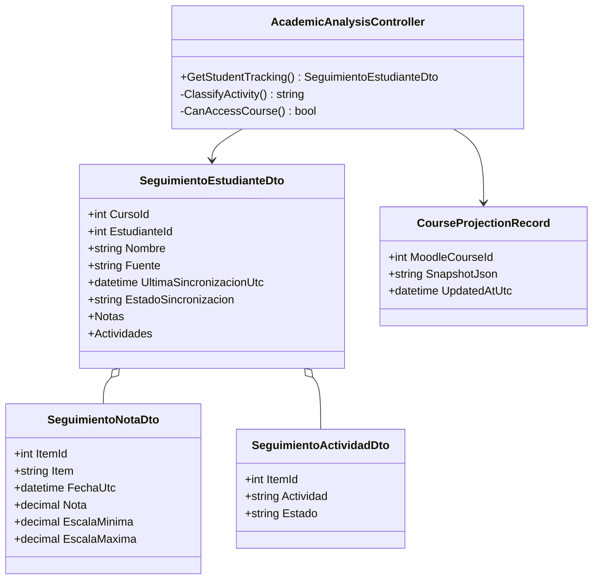

Endpoint expuesto al docente: `GET /api/cursos/{cursoId}/estudiantes/{estudianteId}/seguimiento`. Middleware comprueba el curso y llama a `GET /courses/{cursoId}/students/{estudianteId}/tracking` en Análisis.

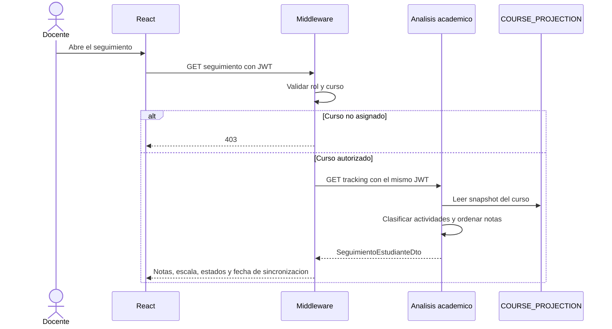

## TA-09.3 — Motor de reglas de alerta

Servicio: Análisis académico. Una regla por curso y tipo. El cambio de umbral o de `activa` se persiste en `ALERT_RULE` y aplica en la siguiente lectura del panel.

La evaluación ocurre al consultar el panel, sobre el snapshot vigente. Si `SyncStatus` no es `Completa`, no se genera ninguna alerta. Los ítems de tipo curso o categoría no entran. Los valores por defecto, si el docente aún no guardó la regla, son descenso 20 %, atraso 3 días y baja finalización 50 %.

`ALERT_STATE` solo guarda la decisión del docente (`Nueva`, `Revisada`, `Descartada`). La evidencia (ítem, valor, fecha y regla) se calcula en la respuesta y no se etiqueta al estudiante de forma definitiva.

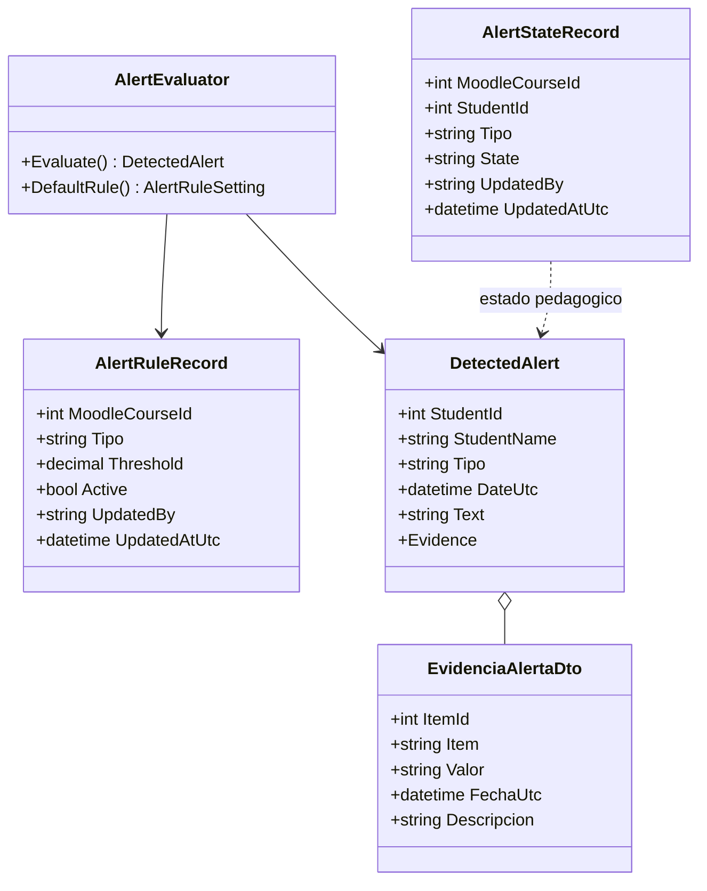

Endpoints del docente, otra vez vía Middleware:

- `GET` y `PUT /api/cursos/{id}/alertas/reglas`
- `GET /api/cursos/{id}/alertas`
- `PATCH /api/cursos/{id}/alertas/{estudianteId}/{tipo}/estado`

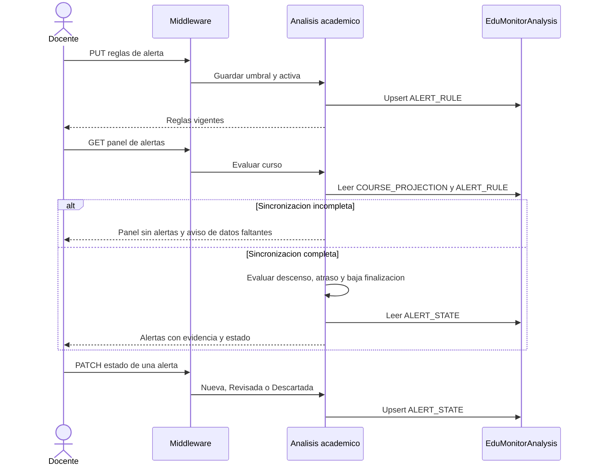

## TA-11.4 — Consulta al agente

La consulta no crea tablas `ConsultaAgente`, `RespuestaAgente` ni `LlamadaHerramienta`. Esas tres piezas son objetos del flujo:

| Objeto de diseño | Dónde vive | Contenido |
|---|---|---|
| ConsultaAgente | `SolicitudAsistenteCursoDto` y `AskRequest` | Curso autorizado, pregunta de 1 a 1000 caracteres, indicadores y análisis grupal ya obtenidos. |
| LlamadaHerramienta | Estado de LangGraph, campo `tool` | `obtener_indicadores_curso` o `obtener_analisis_grupal`, ambas de solo lectura. |
| RespuestaAgente | `AgentAnswer` y `RespuestaAsistenteCursoDto` | Respuesta, hechos, inferencias, recomendaciones, incertidumbre, fuente y fecha de sincronización. |

El texto de la pregunta no se guarda. El evento queda en `AUDIT_LOG` con tipo `ConsultaAgente`, el usuario, la fecha y el resultado (`Exito`, `Error` o `Denegado`).

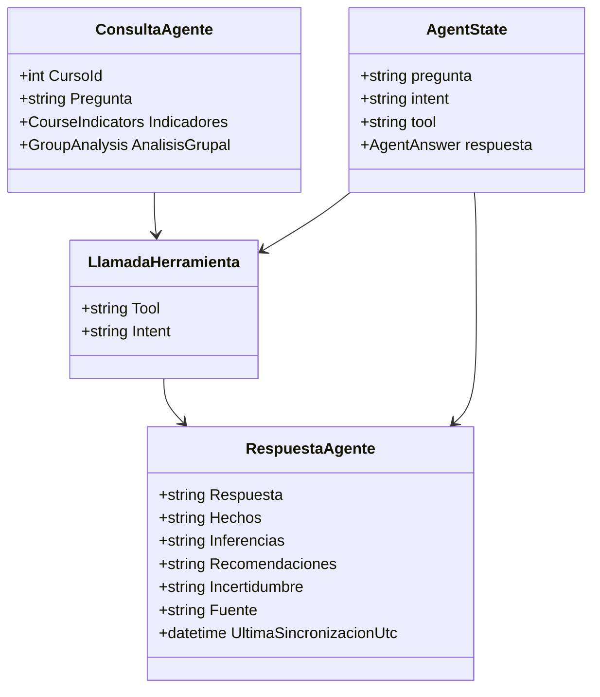

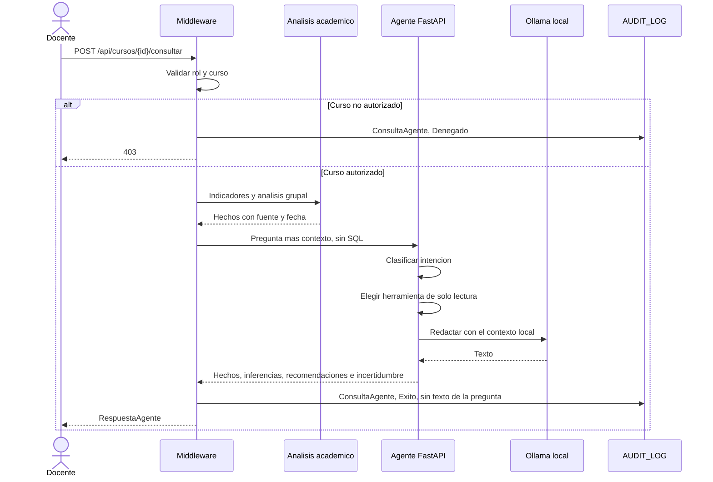

Si el agente no responde, Middleware registra `ConsultaAgente` con resultado `Error` y no inventa el contenido.

## TA-13.3 — Informe del curso

Entidad persistida: `ACADEMIC_REPORT`. El contenido no se parte en tablas hijas. `contenido_json` reúne nombre del curso, período, indicadores, actividades bajo el umbral 6/10 con al menos 7 calificaciones, hallazgos, textos de recomendaciones cuyo estado no es `Descartada` y, si aplica, el aviso de datos incompletos.

El docente genera, lista, consulta y descarga por Middleware:

- `POST /api/cursos/{id}/informes`
- `GET /api/cursos/{id}/informes`
- `GET /api/cursos/{id}/informes/{informeId}`
- `GET /api/cursos/{id}/informes/{informeId}/descargar`

Análisis persiste el registro. La descarga no vuelve a calcular el curso: serializa el JSON ya guardado.

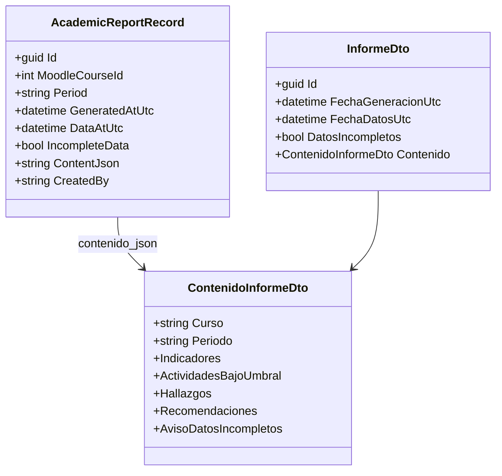

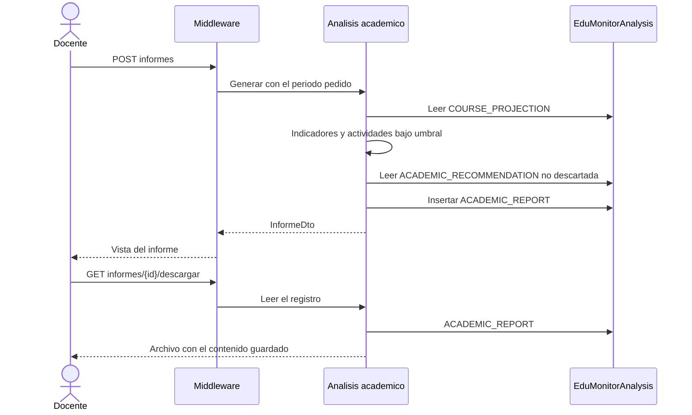

## TA-14.3 — Auditoría

Entidad: `AUDIT_LOG` en `EduMonitor`. Amplía la bitácora `SINCRONIZACION_LOG` del Sprint 1, que sigue existiendo para el resultado técnico de cada sincronización. La consulta unificada del administrador usa `AUDIT_LOG`.

Cada servicio que pasa por Middleware notifica el evento con usuario, rol, fecha, tipo, curso, resultado y un detalle corto. El detalle lo escribe el controlador. No se copian el encabezado `Authorization`, el token de Moodle ni la contraseña. En la consulta al agente el detalle dice de forma explícita que no se guardó la pregunta.

Tipos que el listado acepta al filtrar: `Sincronizacion`, `ConsultaAgente`, `AnalisisGrupal`, `RecomendacionGenerada` y `EstadoRecomendacionActualizado`. Resultados permitidos: `Exito`, `Error` y `Denegado`.

Endpoint: `GET /api/auditoria?tipo&desdeUtc&hastaUtc&pagina&tamanoPagina`. Solo el rol Administrador técnico. Un docente recibe 403 antes de leer la tabla. `tamanoPagina` queda entre 1 y 100.

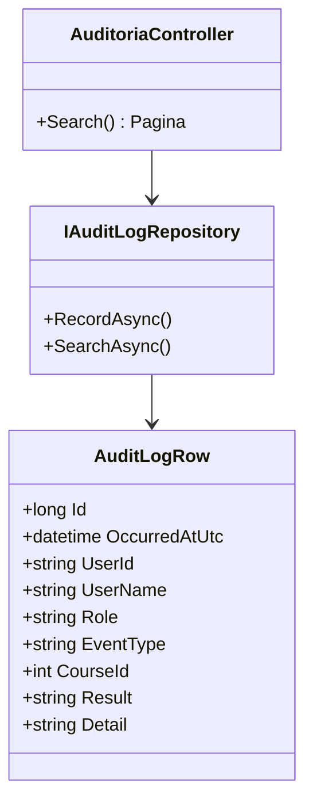

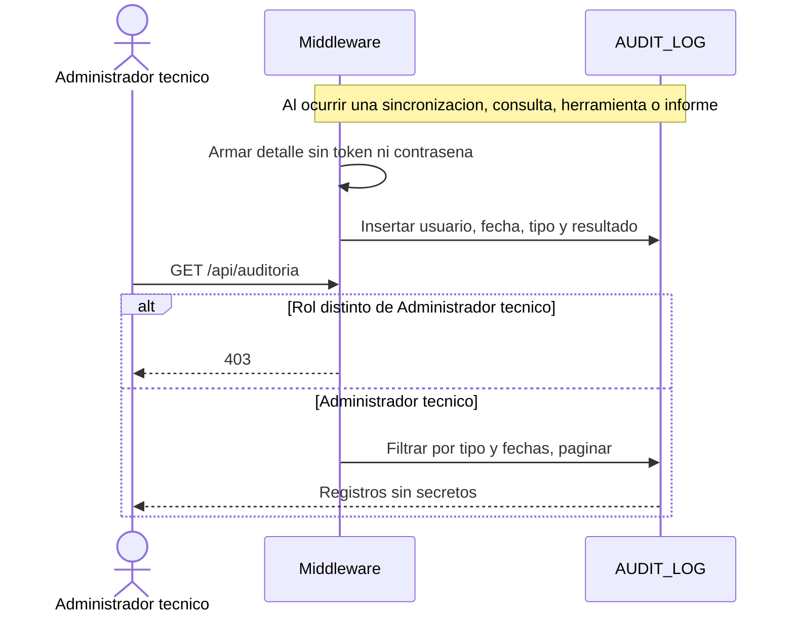

## Coherencia con el Sprint 1

Se conservan `CURSO`, `USUARIO`, `ACTIVIDAD`, `CALIFICACION`, `MAPEO_TEMATICO`, `MATRICULA`, `USUARIO_SISTEMA`, `ASIGNACION_DOCENTE_CURSO` y `SINCRONIZACION_LOG`. Las tablas nuevas no duplican esas entidades: referencian el identificador de Moodle del curso, del estudiante o de la actividad. La autorización por curso sigue en los servicios .NET. El agente solo recibe datos que esos servicios ya filtraron.
